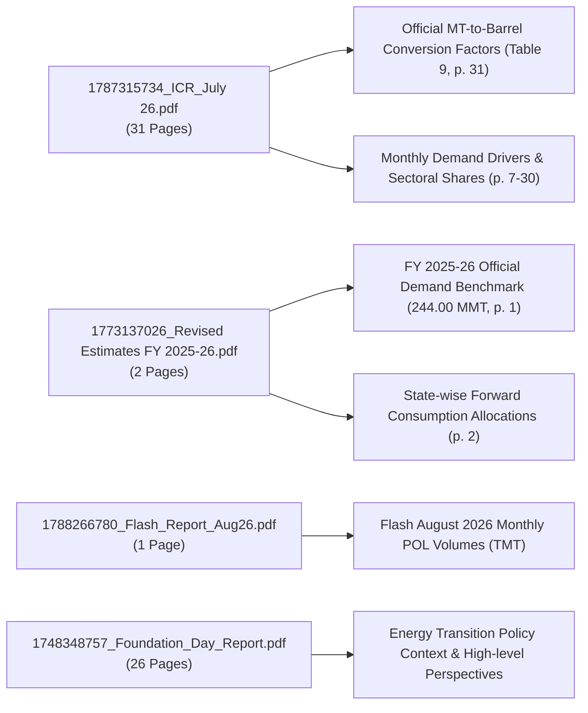
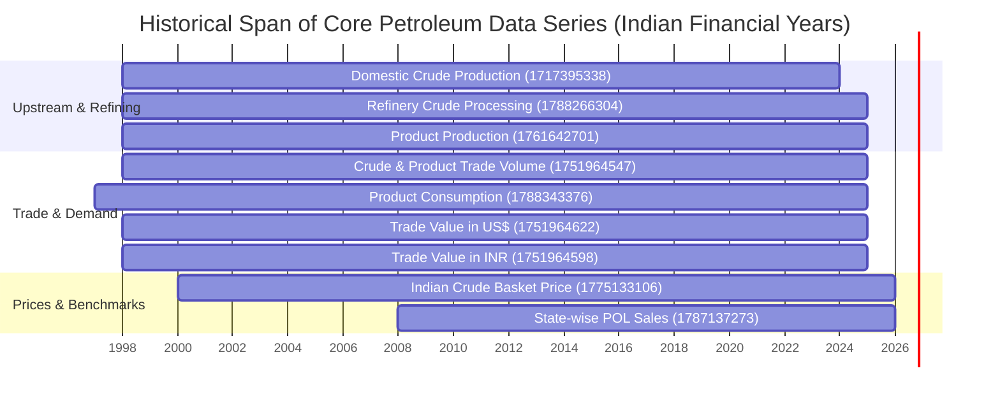

# Phase 1 Source Audit Report: India's Petroleum Supply Chain and Import Exposure

**Project:** *India's Petroleum Supply Chain and Import Exposure: A Historical Analysis of Domestic Production, Refinery Throughput, Petroleum Product Trade and Consumption*  
**Phase:** Phase 1 — Workspace Inventory and Source Audit  
**Author:** Antigravity Research Agent  
**Date of Audit:** October 2026  
**Status:** Complete — Awaiting Researcher Approval at Phase 1 Completion Gate  

---

## 1. Executive Summary

This source audit constitutes the formal completion of **Phase 1** as mandated by the [Master Research Brief](file:///c:/Users/nafis/OneDrive/Desktop/Final-Project/Antigravity_Petroleum_Research_Master_Brief.md). A comprehensive, automated, and reproducible audit of every data file located in [`01_Original_Data`](file:///c:/Users/nafis/OneDrive/Desktop/Final-Project/01_Original_Data) was conducted. No source files were modified, overwritten, or renamed. Raw and processed data layers remain strictly isolated.

### Key Audit Findings at a Glance

| Metric | Verified Value | Analytical Interpretation |
| :--- | :--- | :--- |
| **Total Files Supplied** | 33 files | 29 Excel workbooks + 4 PDF reports |
| **Total Storage Size** | 38,260,379 bytes (~38.31 MB) | Dominated by Foundation Day PDF (33.31 MB); Excel files total ~4.41 MB |
| **Total Worksheets Inspected** | 241 worksheets | 100% of sheets across all 29 workbooks parsed, dimensioned, and classified |
| **File Formats** | 12 `.xls`, 17 `.xlsx`, 4 `.pdf` | 1 critical format mismatch identified and safely resolved |
| **Primary Data Publisher** | Petroleum Planning & Analysis Cell (PPAC) | Ministry of Petroleum & Natural Gas (MoPNG), Government of India |
| **Core Supply Chain Workbooks** | 8 files (7 unique datasets) | Covering Crude Production, Processing, Product Production, Trade, Consumption, Values, Basket Price |
| **Exact Byte Duplicates (SHA-256)** | 2 pairs (4 files) | Petroleum prices & under-recoveries; LNG Imports |
| **Identical Data / OLE2 Timestamp Diff** | 2 pairs (4 files) | Crude oil production; Petroleum product consumption (100% cell match) |
| **Single-Year Redundant Extracts** | 4 files | Single fiscal year monthly extracts of master historical files |
| **Adjacent / Excluded Sources** | 11 files | Natural Gas / LNG (5), Fiscal Subsidies (4), Exchequer (1), Retail Customers (1) |
| **Recommended Common Historical Core** | **FY 1998–99 to FY 2023–24 (26 Years)** | Complete unbroken coverage across all physical supply chain volumes |
| **Recommended Value/Price Window** | **FY 2000–01 to FY 2023–24 (24 Years)** | Full alignment including Indian Crude Basket FOB prices ($/bbl.) |

All primary deliverables for Phase 1 have been compiled and placed in [`02_Source_Audit`](file:///c:/Users/nafis/OneDrive/Desktop/Final-Project/02_Source_Audit):
1. [`file_inventory.csv`](file:///c:/Users/nafis/OneDrive/Desktop/Final-Project/02_Source_Audit/file_inventory.csv) — 33 file records with size, SHA-256 hash, magic signature, readable status, period, frequency, and proposed research role.
2. [`workbook_sheet_inventory.csv`](file:///c:/Users/nafis/OneDrive/Desktop/Final-Project/02_Source_Audit/workbook_sheet_inventory.csv) — 241 worksheet records with dimensions, non-empty row counts, header index, detected units, temporal span, column headings, and notes.
3. [`pdf_inventory.csv`](file:///c:/Users/nafis/OneDrive/Desktop/Final-Project/02_Source_Audit/pdf_inventory.csv) — 4 PDF records detailing structural layout, author, creation date, reporting period, key extractable tables, and research role.
4. [`source_audit_report.md`](file:///c:/Users/nafis/OneDrive/Desktop/Final-Project/02_Source_Audit/source_audit_report.md) — (This document) Comprehensive analytical assessment of data assets.
5. [`data_issues_and_questions.md`](file:///c:/Users/nafis/OneDrive/Desktop/Final-Project/02_Source_Audit/data_issues_and_questions.md) — Detailed catalog of formatting bugs, definition changes, period asymmetries, and decisions requiring approval.

---

## 2. Systematic Typology of Supplied Files

The 33 supplied files have been categorized into four operational tiers based on their relevance to the 11 primary research questions specified in Section 1.1 of the Master Brief:

```mermaid
graph TD
    A["Supplied Data Assets (33 Files)"] --> B["Tier 1: Core Supply Chain (8 Files)"]
    A --> C["Tier 2: Validation & Benchmarking (4 PDFs)"]
    A --> D["Tier 3: Redundant & Single-Year Extracts (6 Files)"]
    A --> E["Tier 4: Supplementary & Excluded Domains (15 Files)"]
    
    B --> B1["Crude Production (1)"]
    B --> B2["Refinery Processing (1)"]
    B --> B3["Product Production (1)"]
    B --> B4["Trade Volumes (1)"]
    B --> B5["Product Consumption (1)"]
    B --> B6["Import Values: USD & INR (2)"]
    B --> B7["Indian Basket Price (1)"]
    
    C --> C1["ICR July 2026 (MT/bbl factors)"]
    C --> C2["Revised Estimates FY 2025-26"]
    C --> C3["Flash Report August 2026"]
    C --> C4["PPAC Foundation Day Report"]
    
    D --> D1["Crude Production (1) Copy"]
    D --> D2["Consumption (1) Copy"]
    D --> D3["Single-Year Import TMT & USD Extracts"]
    
    E --> E1["Natural Gas & LNG (5 Files)"]
    E --> E2["Fiscal Subsidies & Under-recoveries (5 Files)"]
    E --> E3["State-wise Sales & Exchequer (5 Files)"]
```

### 2.1 Tier 1: Core Supply Chain Files (Authoritative Historical Series)

These 8 workbooks form the empirical foundation for the primary historical study:

1. **Domestic Crude Oil Production:**  
   - File: [`1717395338_PT_Crude_oil_production_H.xls`](file:///c:/Users/nafis/OneDrive/Desktop/Final-Project/01_Original_Data/1717395338_PT_Crude_oil_production_H.xls)  
   - Sheet: `PT_PRODUCTION_H` (31 rows × 27 cols)  
   - Unit: Million Metric Tonnes (MMT)  
   - Period: FY 1998–99 to FY 2023–24 (Provisional for 2022–23 and 2023–24)  
   - Key Variables: ONGC, OIL, PSU Total, Private/JVC, Total Crude Oil, Condensate (broken out separately from 2006–07), Total Crude Oil + Condensate.
2. **Refinery Crude Oil Processing:**  
   - File: [`1788266304_PT_crude_processing_H.xls`](file:///c:/Users/nafis/OneDrive/Desktop/Final-Project/01_Original_Data/1788266304_PT_crude_processing_H.xls)  
   - Primary Sheet: `PT_CRUDE_H` (64 rows × 30 cols) + 16 monthly FY sheets  
   - Unit: Thousand Metric Tonnes ('000 Metric Tonnes / TMT)  
   - Period: FY 1998–99 to FY 2024–25 (Annual final), FY 2025–26 (Provisional), FY 2026–27 Till June (Provisional partial)  
   - Key Variables: Refinery-by-refinery crude throughput (IOCL, BPCL, HPCL, CPCL, MRPL, ONGC, NRL, BORL/BPCL, RIL DTA, RIL SEZ, Nayara/EOL), Sector Totals, Grand Total.
3. **Petroleum Product Production:**  
   - File: [`1761642701_PT_production_product_H.xls`](file:///c:/Users/nafis/OneDrive/Desktop/Final-Project/01_Original_Data/1761642701_PT_production_product_H.xls)  
   - Primary Sheet: `PT_PRODUCTION_H` (30 rows × 29 cols) + 16 monthly FY sheets  
   - Unit: Thousand Metric Tonnes ('000 Metric Tonnes / TMT)  
   - Period: FY 1998–99 to FY 2024–25 (Provisional), FY 2025–26 Apr-Sep (Provisional partial)  
   - Key Variables: Production by major product (LPG, Naphtha, MS, ATF, SKO, HSD, LDO, Lubes, FO, LSHS, Bitumen, Others*, Total).
4. **Historical Petroleum Trade Quantities (Imports & Exports):**  
   - File: [`1751964547_PT_IMPORT_TMT_H.xlsx`](file:///c:/Users/nafis/OneDrive/Desktop/Final-Project/01_Original_Data/1751964547_PT_IMPORT_TMT_H.xlsx)  
   - Primary Sheet: `PT_IMPORT_H` (52 rows × 28 cols) + 15 monthly FY sheets  
   - Unit: Thousand Metric Tonnes ('000 Metric Tonnes / TMT)  
   - Period: FY 1998–99 to FY 2024–25 (27 financial years)  
   - Key Variables: Crude Oil Imports, Product Imports by product (LPG, MS, Naphtha, ATF, SKO, HSD, LOBS, Fuel Oil, Bitumen, Others), Total Product Imports, Total Imports; Product Exports by product (LPG, MS, Naphtha, ATF, SKO, HSD, LDO, LOBS, Fuel Oil, Bitumen, Others), Total Product Exports, Net Imports, Net Product Exports.  
   - *Crucial Observation:* There is no Crude Oil Export row.
5. **Petroleum Product Consumption (Market Demand):**  
   - File: [`1788343376_PT_Consumption_English.xls`](file:///c:/Users/nafis/OneDrive/Desktop/Final-Project/01_Original_Data/1788343376_PT_Consumption_English.xls)  
   - Primary Sheet: `Historical (year-wise)` (29 rows × 58 cols) + 28 individual FY sheets  
   - Unit: Thousand Metric Tonnes ('000 Metric Tonne / TMT)  
   - Period: FY 1997–98 to FY 2024–25 (Annual final), FY 2025–26 (Provisional)  
   - Key Variables: Product consumption (LPG, Naphtha, MS, ATF, SKO, HSD, LDO, Lubricants & Greases, FO & LSHS, Bitumen, Petroleum coke, Others, Total) alongside YoY growth rates.
6. **Petroleum Import & Export Value (US Dollars):**  
   - File: [`1751964622_PT_IMPORT_VAL_US$_H.xlsx`](file:///c:/Users/nafis/OneDrive/Desktop/Final-Project/01_Original_Data/1751964622_PT_IMPORT_VAL_US$_H.xlsx)  
   - Primary Sheet: `PT_IMPORT_VAL$_H` (52 rows × 28 cols) + 16 monthly FY sheets  
   - Unit: Million US$ (Nominal)  
   - Period: FY 1998–99 to FY 2024–25 (27 financial years)  
   - Key Variables: Crude Oil Import Value, Product Import Value by product, Total Import Value, Product Export Value by product, Total Export Value, Net Import Value.
7. **Petroleum Import & Export Value (Indian Rupees):**  
   - File: [`1751964598_PT_IMPORT_VAL_RS.CRS._H.xlsx`](file:///c:/Users/nafis/OneDrive/Desktop/Final-Project/01_Original_Data/1751964598_PT_IMPORT_VAL_RS.CRS._H.xlsx)  
   - Primary Sheet: `PT_IMPORT_VALRS_H` (52 rows × 36 cols) + 16 monthly FY sheets  
   - Unit: Rs. Crore (` Crore / Nominal)  
   - Period: FY 1998–99 to FY 2024–25 (27 financial years)  
   - Key Variables: Symmetrical categories to the USD workbook, reported in domestic currency.
8. **Indian Crude Oil Basket FOB Price:**  
   - File: [`1775133106_PP_Crude-Oil-FOB-Price-(Indian Basket)-Historical.xlsx`](file:///c:/Users/nafis/OneDrive/Desktop/Final-Project/01_Original_Data/1775133106_PP_Crude-Oil-FOB-Price-(Indian Basket)-Historical.xlsx)  
   - Sheet: `Sheet1` (54 rows × 16 cols)  
   - Unit: US Dollars per Barrel ($/bbl.)  
   - Period: FY 2000–01 to FY 2025–26 (26 financial years)  
   - Key Variables: Monthly average daily FOB prices (April through March), Annual Financial Year Average, and documented Sour:Sweet composition ratio.

---

## 3. PDF Reports: Structure, Extractable Evidence, and Research Utility

Four official PDF reports published by PPAC were inspected, page-by-page text-extracted, and inventoried. They serve vital roles for parameter acquisition, recent-period cross-checking, and qualitative validation.

### Detailed Evaluation of PDF Documents

1. **PPAC Industry Consumption Report (ICR) — July 2026 (`1787315734_ICR_July 26.pdf`)**
   - *Size & Extent:* 2,147,161 bytes; 31 pages.
   - *Author / Date:* PPAC; published August 2026 (reporting period July 2026 and cumulative Apr–Jul 2026).
   - *Critical Asset for the Research:* **Table-9 (Page 31) — "Conversion factors taken for MT to barrel conversion"**. This table provides the exact official density-based conversion factors used by the Indian Government:
     - LPG: \(1\text{ MT} = 11.6\text{ bbl}\)
     - SKO (Kerosene): \(1\text{ MT} = 8.1\text{ bbl}\)
     - Diesel (HSD): \(1\text{ MT} = 7.6\text{ bbl}\)
     - Petrol (MS): \(1\text{ MT} = 8.9\text{ bbl}\)
     - Naphtha: \(1\text{ MT} = 8.7\text{ bbl}\)
     - ATF: \(1\text{ MT} = 8.1\text{ bbl}\)
     - Bitumen: \(1\text{ MT} = 6.1\text{ bbl}\)
     - Furnace Oil: \(1\text{ MT} = 6.7\text{ bbl}\)
     - Lubes: \(1\text{ MT} = 7.2\text{ bbl}\)
     - Light Diesel Oil (LDO): \(1\text{ MT} = 7.4\text{ bbl}\)
     - Petcoke: \(1\text{ MT} = 5.5\text{ bbl}\)
     - Product Basket (for Others): \(1\text{ MT} = 8.1\text{ bbl}\)
   - *Analytical Utility:* Essential for Phase 2 and Phase 5 unit standardization. Prevents arbitrary density assumptions.

2. **Revised Estimates FY 2025–26 Combined (`1773137026_Revised Estimates FY 2025-26_Combined.pdf`)**
   - *Size & Extent:* 947,758 bytes; 2 pages.
   - *Author / Date:* PPAC (Author: DO Demand); created March 10, 2026.
   - *Page 1 Contents:* Official Revised Estimates of Petroleum Product Consumption for FY 2025–26:
     - Sensitive Products: LPG (33,702 TMT), SKO (449 TMT); Subtotal: 34,150 TMT.
     - Major Decontrolled Products: MS (42,534 TMT), Naphtha (11,699 TMT), HSD (94,087 TMT), ATF (9,131 TMT), LDO (1,006 TMT), Lubes (4,921 TMT), FO/LSHS (6,142 TMT), Bitumen (9,094 TMT); Subtotal: 178,613 TMT.
     - Minor Decontrolled Products: Petcoke (20,962 TMT), Others (10,277 TMT); Subtotal: 31,239 TMT.
     - **All Products RE 2025–26:** **244,002 TMT (244.00 MMT)**.
   - *Page 2 Contents:* State-wise allocations for LPG, MS, HSD, ATF across 36 States/UTs.
   - *Analytical Utility:* Acts as an authoritative external validation benchmark for Phase 7.

3. **PPAC Flash Report on Oil & Gas — August 2026 (`1788266780_Flash_Report_WEB_UPLOAD_Aug26.pdf`)**
   - *Size & Extent:* 538,706 bytes; 1 page.
   - *Author / Date:* PPAC (Parminder Kaur); created September 1, 2026.
   - *Contents:* Preliminary flash numbers for August 2026 (Petrol: 3,824 TMT; Diesel: 7,001 TMT; ATF: 720 TMT; LPG: 2,424 TMT) and cumulative FY 2026–27 (Apr–Aug) vs FY 2025–26.
   - *Analytical Utility:* Highly provisional recent data. Must remain strictly separated from final historical series.

4. **24th PPAC Foundation Day Report (`1748348757_Foundation_Day_Report_vfinal_26052025.pdf`)**
   - *Size & Extent:* 33,313,210 bytes (~33.31 MB); 26 pages.
   - *Contents:* Proceedings of the Foundation Day event held on April 29, 2025, titled "Dialogues on Energy: Security & Transition". Includes panel discussions on energy security frameworks, refining resilience, bio-fuels, green hydrogen, and financing mechanisms.
   - *Analytical Utility:* Qualitative context for Introduction and Discussion sections (Phase 9). Does not contain structured historical time-series tables.

---

## 4. Deep Inspection of Duplicates, Overlaps, and Redundant Extracts

A rigorous byte-level and cell-by-cell comparison was conducted across all candidate pairs. The results are summarized below:

| Candidate Pair | Exact SHA-256 Match? | Data Parity | Root Cause / Nature of Relationship | Audit Decision |
| :--- | :---: | :---: | :--- | :--- |
| `1761715894_petroleum-prices-and-under-recoveries.xlsx` vs `... (1).xlsx` | **YES** `2e959a...` | **100.0%** | Exact byte duplicate created by redundant download. | Retain `(1)` in audit record; use unnumbered master. |
| `1781164918_NG-H_LNG_Import.xlsx` vs `... (1).xlsx` | **YES** `c2a47c...` | **100.0%** | Exact byte duplicate created by redundant download. | Retain `(1)` in audit record; use unnumbered master. |
| `1717395338_PT_Crude_oil_production_H.xls` vs `... (1).xls` | **NO** (Hash diff) | **100.0%** (All cells identical) | Binary difference caused by OLE2 internal directory timestamps upon separate browser saves. | Authoritative primary file: `1717395338_PT_Crude_oil_production_H.xls`. Retain `(1)` in audit record. |
| `1788343376_PT_Consumption_English.xls` vs `... (1).xls` | **NO** (Hash diff) | **100.0%** (All 29 sheets identical) | Identical data across 29 sheets; binary difference caused by OLE2 filesystem metadata timestamps. | Authoritative primary file: `1788343376_PT_Consumption_English.xls`. Retain `(1)` in audit record. |
| `1729493890_pt_import_en.xlsx` vs `1751964547_PT_IMPORT_TMT_H.xlsx` | **NO** (Subset) | **100.0%** of FY24 monthly sheet | Single-sheet workbook containing FY 2023–24 monthly trade data; exact subset of sheet `PT_IMPORT_2023-24` in master file. | Master historical file supersedes single-year extract. |
| `1729493957_val-in-dollar_en.xlsx` vs `1751964622_PT_IMPORT_VAL_US$_H.xlsx` | **NO** (Subset) | **100.0%** of FY24 monthly sheet | Single-sheet workbook containing FY 2023–24 monthly USD trade value; exact subset of sheet `PT_Import_Val_2023-24` in master file. | Master historical file supersedes single-year extract. |
| `1751966513_val-in-dollar-en.xlsx` vs `1751964622_PT_IMPORT_VAL_US$_H.xlsx` | **NO** (Subset) | **100.0%** of FY25 monthly sheet | Single-sheet workbook containing FY 2024–25 monthly USD trade value; exact subset of sheet `PT_Import_Val_2024-25` in master file. | Master historical file supersedes single-year extract. |
| `1784609810_PT_IMPORT_VAL_US$_25-26.xlsx` vs `1751964622_PT_IMPORT_VAL_US$_H.xlsx` | **NO** (Forward period) | Unique FY26 monthly values | Single-sheet workbook containing provisional monthly trade values for FY 2025–26. Extends master historical series forward. | Retain as supplementary / provisional forward validation. |
| `1787119859_PT_Import_Val_USD.xls` vs All Import Files | **NO** (Anomaly) | Partial early-year values | Labeled "2026-27" in cell R4:C0 but contains monthly values only for April–July (and 0 for remaining months). | Flagged anomaly; do not merge into historical core without validation. |

---

## 5. Research Questions to Candidate Source Mapping

The Master Brief sets out 11 core research questions. The table below maps each question directly to its candidate workbook, primary worksheet, specific variable rows, and data feasibility:

| Research Question (RQ) | Candidate Source File | Primary Worksheet | Exact Variables / Rows | Units | Historical Feasibility |
| :--- | :--- | :--- | :--- | :--- | :--- |
| **RQ 1: Domestic crude oil production trends** | `1717395338_PT_Crude_oil_production_H.xls` | `PT_PRODUCTION_H` | ONGC (R11), OIL (R12), PSU Total (R13), Private/JVC (R15), Total Crude (R16), Condensate (R18), Grand Total (R19) | MMT | **Fully Supported** (FY 1998–99 to 2023–24) |
| **RQ 2: Crude oil imports and exports** | `1751964547_PT_IMPORT_TMT_H.xlsx` | `PT_IMPORT_H` | CRUDE OIL$ Imports (R10); No crude exports reported under Exports | TMT | **Fully Supported** for Imports (FY 1998–99 to 2024–25); Exports zero/not reported |
| **RQ 3: Domestic production vs. refinery processing** | `1788266304_PT_crude_processing_H.xls` & Production file | `PT_CRUDE_H` & `PT_PRODUCTION_H` | GRAND TOTAL Crude Processed (R61) vs Total Crude Production | TMT (Production converted from MMT: \(\times 1000\)) | **Fully Supported** over common window (FY 1998–99 to 2023–24) |
| **RQ 4: Apparent crude import dependence proxy** | Computed from RQ 1 & RQ 2 | Master Supply Chain | \(D_t = \frac{M_t}{P_t + M_t} \times 100\) (or relative to refinery throughput \(T_t\)) | Ratio (%) | **Fully Supported** (Proxy metric clearly documented vs official PPAC definition) |
| **RQ 5: Petroleum product production trends** | `1761642701_PT_production_product_H.xls` | `PT_PRODUCTION_H` | Individual product rows: LPG, Naphtha, MS, ATF, SKO, HSD, LDO, Lubes, FO, LSHS, Bitumen, Others, Total | TMT | **Fully Supported** (FY 1998–99 to 2023–24 final, 2024–25 provisional) |
| **RQ 6: Petroleum product imports and exports** | `1751964547_PT_IMPORT_TMT_H.xlsx` | `PT_IMPORT_H` | Product Imports (R12-R22) & Product Exports (R26-R38) by individual product streams | TMT | **Fully Supported** (FY 1998–99 to 2024–25) |
| **RQ 7: Domestic petroleum product consumption** | `1788343376_PT_Consumption_English.xls` | `Historical (year-wise)` | Product rows: LPG, Naphtha, MS, ATF, SKO, HSD, LDO, Lubes, FO/LSHS, Bitumen, Petcoke, Others, Total | TMT | **Fully Supported** (FY 1997–98 to 2024–25 final, 2025–26 provisional) |
| **RQ 8: Dominant consumption products & net trade balances** | Synthesized from Trade (RQ 6) & Consumption (RQ 7) | Harmonized Product Layer | Trade balance \(B_{i,t} = X_{i,t} - M_{i,t}\); Product consumption ranking | TMT | **Fully Supported** for matched product definitions across FY 1998–99 to 2024–25 |
| **RQ 9: Petroleum import expenditure & unit-value changes** | `1751964622_PT_IMPORT_VAL_US$_H.xlsx`, Trade file & Basket Price | `PT_IMPORT_VAL$_H`, `PT_IMPORT_H`, `Sheet1` | Crude & Product Import Values (US$ Million), Import Quantities (TMT), Indian Basket FOB ($/bbl.) | US$ Million, TMT, $/bbl. | **Fully Supported** (FY 2000–01 to 2024–25 for price joint analysis; 1998–99 to 2024–25 for values) |
| **RQ 10: Divergences across crude, processing, trade & demand** | Multi-file integrated dataset | Derived Analytical Layer | Comparative indexation, growth differentials, refinery yield ratios, domestic supply gap | Standardized units & index | **Fully Supported** over approved common core window |
| **RQ 11: Supply chain exposure & boundary limits** | Synthesized results & audit limitations | Discussion & Synthesis | Explicit evidence-backed findings vs claims unsupported by data | Analytical conclusions | **Fully Supported** with limitations explicitly bounded |

---

## 6. Historical Period Coverage and Alignment Analysis

A critical task in Phase 1 is evaluating the historical temporal boundary of every core series to recommend the most robust common time window for subsequent phases.

### Period Analysis & Trade-Offs

1. **The Upper Boundary Constraint (Crude Production Truncation):**  
   - Most core historical files (Refinery Processing, Product Production, Trade TMT, Trade USD, Trade INR, and Consumption) extend through **FY 2024–25**.  
   - However, domestic crude oil production in [`1717395338_PT_Crude_oil_production_H.xls`](file:///c:/Users/nafis/OneDrive/Desktop/Final-Project/01_Original_Data/1717395338_PT_Crude_oil_production_H.xls) terminates at **FY 2023–24 (Provisional)**.  
   - *Implication:* Without an official, verified figure for FY 2024–25 domestic crude production, the complete supply-chain reconciliation (linking domestic production + crude imports to refinery processing) cannot extend beyond FY 2023–24 in the primary master table.

2. **The Lower Boundary Constraint (Price Series Truncation):**  
   - Volume series for crude production, refinery processing, trade, and product production begin in **FY 1998–99** (with consumption starting in FY 1997–98).  
   - However, the official Indian Crude Basket FOB price series in [`1775133106_PP_Crude-Oil-FOB-Price-(Indian Basket)-Historical.xlsx`](file:///c:/Users/nafis/OneDrive/Desktop/Final-Project/01_Original_Data/1775133106_PP_Crude-Oil-FOB-Price-(Indian Basket)-Historical.xlsx) begins in **FY 2000–01**.  
   - *Implication:* Any econometric, decomposition, or correlation analysis involving the benchmark crude price must either use FY 2000–01 as its base year or treat FY 1998–99 to 1999–2000 as a volume-only period.

### Formal Recommendation for Common Time Windows

Based on the evidence, Antigravity recommends a two-tier historical window structure:

* **Primary Supply Chain Analysis Window:** **FY 1998–99 to FY 2023–24 (26 Financial Years)**  
  *Rationale:* Provides a complete, unbroken annual series across domestic crude production, crude imports, refinery processing, product production, product trade, and domestic consumption.
* **Extended Price & Import Expenditure Window:** **FY 2000–01 to FY 2023–24 (24 Financial Years)** (or through **FY 2024–25** for trade value and unit values if domestic crude production is excluded from that specific sub-analysis).
* **Recent Period Benchmarking (Supplementary):** **FY 2024–25 to FY 2025–26** documented separately as preliminary / revised estimates using the ICR July 2026 report and Revised Estimates PDF.

---

## 7. Standard Physical Units and Conversion Architecture

A core requirement of academic integrity is transparent unit handling. The source files report figures across several physical and monetary scales:

| Variable | Raw Source Unit | Standardized Analytical Unit | Conversion Applied | Source Authority |
| :--- | :--- | :--- | :--- | :--- |
| **Domestic Crude Production** | Million Metric Tonnes (MMT) | Thousand Metric Tonnes (TMT) | \(\text{TMT} = \text{MMT} \times 1,000\) | Mathematical identity |
| **Refinery Crude Processing** | '000 Metric Tonnes (TMT) | Thousand Metric Tonnes (TMT) | None (Native TMT) | PPAC Source Header |
| **Product Production** | '000 Metric Tonnes (TMT) | Thousand Metric Tonnes (TMT) | None (Native TMT) | PPAC Source Header |
| **Trade Quantities (Crude & Products)** | '000 Metric Tonnes (TMT) | Thousand Metric Tonnes (TMT) | None (Native TMT) | PPAC Source Header |
| **Product Consumption** | '000 Metric Tonne (TMT) | Thousand Metric Tonnes (TMT) | None (Native TMT) | PPAC Source Header |
| **Import Expenditure (USD)** | Million US$ | Million US$ (Nominal) | None (Native USD) | PPAC Source Header |
| **Import Expenditure (INR)** | Rs. Crore (` Crore) | Rs. Crore (Nominal) | None (Native INR) | PPAC Source Header |
| **Crude Oil Basket Price** | $/bbl. | $/bbl. (Nominal) | None (Native $/bbl) | PPAC Source Header |
| **Metric Tonnes to Barrels** | Metric Tonnes (MT) | Barrels (bbl.) | Product-specific factors | **PPAC ICR July 2026, Table 9 (p. 31)** |

> [!IMPORTANT]
> Universal fixed conversion factors (such as \(1\text{ tonne} = 7.33\text{ barrels}\)) will **not** be applied across petroleum products. Product densities vary widely: LPG yields \(11.6\text{ bbl/MT}\), whereas Bitumen yields only \(6.1\text{ bbl/MT}\). When volume conversions between tonnes and barrels are required, the official PPAC Table 9 factors documented in Section 3 will be applied strictly.

---

## 8. Summary of Excluded and Adjacent Datasets

In accordance with Section 1.2 and 2.4 of the Master Brief, eleven files in [`01_Original_Data`](file:///c:/Users/nafis/OneDrive/Desktop/Final-Project/01_Original_Data) were audited but are recommended for exclusion from the core crude oil and petroleum product balance:

1. **Natural Gas & LNG Workbooks (5 files):**  
   - `1781164726_NG_H_Production.xls` (NG Production)  
   - `1781164814_NG-H_LNG_Consumption.xlsx` (NG/LNG Consumption)  
   - `1781164918_NG-H_LNG_Import.xlsx` and `... (1).xlsx` (LNG Imports)  
   - `1781859871_2_NG-H_Sectoral_Consumption.xlsx` (Sectoral NG Consumption)  
   - *Reason for Exclusion:* Natural gas is physically, industrially, and statistically distinct from crude oil refining and POL product flows. Retained in inventory for potential secondary extensions.
2. **Fiscal Subsidies and Under-recoveries (4 files):**  
   - `1679651218_163fd52aba7df0b51c90.xls` (PPAC PS_1 Kerosene/LPG Fiscal Subsidy 2002–2015)  
   - `1785758008_Subsidy_Natural_Gas_in_North_East_Region.xlsx` (NE Gas Subsidies)  
   - `1785841030_Under_Recoveries_... .xls` (OMC Under-recoveries on Sensitive Products)  
   - `1761715894_petroleum-prices-and-under-recoveries.xlsx` and `... (1).xlsx` (Fortnightly Under-recoveries)  
   - *Reason for Exclusion:* Represents fiscal and pricing compensation mechanisms rather than physical supply-chain volumes or macro import expenditure.
3. **Downstream Pricing & Customer Distribution (2 files):**  
   - `1734585644_Dealer_Commision_MS_HSD_english_01.12. 2024.xls` (Dealer commissions & retail pump prices)  
   - `1787123639_active-domestic-cus-lpg.xlsx` (Active domestic LPG customer counts as of August 2026)  
   - *Reason for Exclusion:* Highly specific downstream operational snapshots outside the macroeconomic and physical supply chain scope.

---

## 9. Phase 1 Completion Gate and Next Steps

### Gate Checklist Verification

- [x] Every file in `01_Original_Data` inventoried recursively (33 files identified, verified, and characterized).
- [x] Exact filenames, file types, byte sizes, magic signatures, and readable statuses recorded.
- [x] Every worksheet of every Excel workbook inspected (241 sheets; dimensions, headers, units, date coverage, and notes recorded).
- [x] Structure and extractable text of every PDF inspected (titles, dates, tables, page references recorded).
- [x] Duplicates, versioning, single-year extracts, missing files, and format anomalies documented without altering raw files.
- [x] Older `.xls` workbooks supported via `xlrd`; missing library safely installed; OOXML format mismatch safely handled.
- [x] All 5 required Phase 1 deliverables created in `02_Source_Audit`.
- [x] Relevance to research questions established with clear separation between verified observations and interpretations.
- [x] No data invented, no conflicting values silently reconciled.
- [x] STOP executed: awaiting researcher approval before commencing Phase 2.

### Recommendation for Phase 2

Upon researcher approval of this audit report and resolution of the decisions outlined in [`data_issues_and_questions.md`](file:///c:/Users/nafis/OneDrive/Desktop/Final-Project/02_Source_Audit/data_issues_and_questions.md), the project will advance to **Phase 2 (Data Extraction and Construction of a Verified Dataset)**:
1. Establish the raw extraction layer under `data/raw_extracted/`.
2. Extract the authoritative historical sheets for domestic crude production, refinery throughput, product production, trade volumes, trade values, product consumption, and basket price into clean tabular format.
3. Standardize units to Thousand Metric Tonnes (TMT) for all physical volumes and Million US$ / Rs Crore for monetary series.
4. Establish the unified data dictionary and provenance log.
