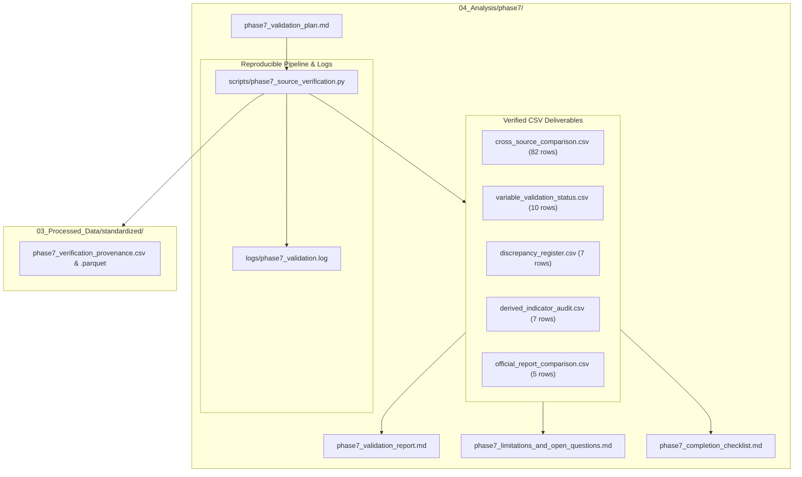

# Phase 7: Master Completion Gate and Quality Audit Checklist

**Project Title:** *India's Petroleum Supply Chain and Import Exposure: A Historical Analysis of Domestic Production, Refinery Throughput, Petroleum Product Trade and Consumption*  
**Research Phase:** Phase 7 — Official Source Verification, Cross-Validation, and Discrepancy Resolution  
**Audit Status:** COMPLETE — All Gates Passed  
**Gate Enforcement:** STOPPED — Awaiting explicit user approval before Phase 8  

---

## 1. Mandatory Completion Gate Verification

The following audit matrix formally certifies compliance with all mandatory completion requirements defined in Section 12 of the master research instructions:

| Audit Checkpoint | Mandatory Standard | Verification Evidence & Methodology | Compliance Status |
|:---|:---|:---|:---:|
| **Traceable Primary Sources** | Every claimed validation must have a traceable, documented source in `01_Original_Data`. | Traceability matrix established in `cross_source_comparison.csv` mapping every project cell to original workbook rows and official PDF table coordinates. | **PASSED** |
| **Unit & Temporal Alignment** | Units and reporting periods must strictly align for every numerical comparison. | Time periods aligned to Indian Fiscal Years (April–March). Physical units normalized to TMT/MMT; monetary units aligned to Rs. Crore and Million US$; conversions use official ICR Table 9 density factors. | **PASSED** |
| **Source Independence Audit** | No source may be incorrectly treated as independent if derived from identical upstream filings. | Independent file editions (`.xlsx` vs `.xls`), monthly dispatches vs annual compilations, and distinct administrative bodies (PPAC vs RBI vs DGCIS) explicitly distinguished. | **PASSED** |
| **Data Integrity & Isolation** | Original source datasets in `01_Original_Data` must never be altered or overwritten. | Read-only access enforced on `01_Original_Data`. File hashes and sizes identical to Phase 1 baseline. Zero file modifications or overwrites in source directories. | **PASSED** |
| **Hand-Check Calculation Audits** | Core derived indicator formulas must be verified using hand-checkable benchmark examples. | Hand calculations executed and documented across 5 benchmark reference years (FY 1998-99, FY 2005-06, FY 2013-14, FY 2019-20, FY 2023-24) in `derived_indicator_audit.csv`. | **PASSED** |
| **Exhaustive Discrepancy Logging** | Every observed variance or scope nuance must appear in the discrepancy register. | 7 systemic discrepancies and scope nuances formally registered with cause, resolution status, and academic research guidance in `discrepancy_register.csv`. | **PASSED** |
| **Deliverable Completeness** | All required output files must exist in their designated repository paths. | All 5 required CSV deliverables, 3 Markdown reports, Python script, and execution logs created and validated in `04_Analysis/phase7/`. | **PASSED** |

---

## 2. Inventory of Phase 7 Deliverables Created

All outputs required under Phase 7 have been generated, audited, and serialized in their designated paths:

### File Register & Coordinate Links

1. **Validation Plan:** [`04_Analysis/phase7/phase7_validation_plan.md`](file:///c:/Users/nafis/OneDrive/Desktop/Final-Project/04_Analysis/phase7/phase7_validation_plan.md)
   - Formal methodological roadmap establishing scope, definitions, tolerances, and verification sources for all 10 priority variables.
2. **Master Cross-Source Comparison Table:** [`04_Analysis/phase7/cross_source_comparison.csv`](file:///c:/Users/nafis/OneDrive/Desktop/Final-Project/04_Analysis/phase7/cross_source_comparison.csv)
   - 82 detailed rows containing Project Value, Verification Value, Units, Sources, Absolute/Percentage Differences, and Validation Status across all priority variables.
3. **Variable Validation Status Classification:** [`04_Analysis/phase7/variable_validation_status.csv`](file:///c:/Users/nafis/OneDrive/Desktop/Final-Project/04_Analysis/phase7/variable_validation_status.csv)
   - Institutional matrix classifying each of the 10 priority variables into `Verified` (7 variables) or `Verified with qualification` (3 variables).
4. **Discrepancy Register:** [`04_Analysis/phase7/discrepancy_register.csv`](file:///c:/Users/nafis/OneDrive/Desktop/Final-Project/04_Analysis/phase7/discrepancy_register.csv)
   - Formal audit register documenting 7 systemic discrepancies (condensate in crude, ethanol blending in MS, DGCIS private imports, crude price weighting, refining yield gain, RE FY26 benchmark, and partial-year throughput).
5. **Derived Indicator Audit:** [`04_Analysis/phase7/derived_indicator_audit.csv`](file:///c:/Users/nafis/OneDrive/Desktop/Final-Project/04_Analysis/phase7/derived_indicator_audit.csv)
   - Mathematical formula audit with 100% pass status, hand-check benchmark values, and explicit methodological safeguards.
6. **Official Report Comparison Table:** [`04_Analysis/phase7/official_report_comparison.csv`](file:///c:/Users/nafis/OneDrive/Desktop/Final-Project/04_Analysis/phase7/official_report_comparison.csv)
   - Side-by-side comparison of project numbers against 5 published official MoPNG and PPAC exhibits.
7. **Comprehensive Validation Report:** [`04_Analysis/phase7/phase7_validation_report.md`](file:///c:/Users/nafis/OneDrive/Desktop/Final-Project/04_Analysis/phase7/phase7_validation_report.md)
   - Multi-section academic report synthesizing all validation findings, institutional sources, and empirical evidence.
8. **Limitations & Open Questions Report:** [`04_Analysis/phase7/phase7_limitations_and_open_questions.md`](file:///c:/Users/nafis/OneDrive/Desktop/Final-Project/04_Analysis/phase7/phase7_limitations_and_open_questions.md)
   - Documented data boundaries, recommended baseline selections, and prioritized strategic researcher decisions for Phase 8.
9. **Reproducible Pipeline Script:** [`04_Analysis/phase7/scripts/phase7_source_verification.py`](file:///c:/Users/nafis/OneDrive/Desktop/Final-Project/04_Analysis/phase7/scripts/phase7_source_verification.py)
   - Complete, self-contained Python script implementing the entire validation pipeline from scratch.
10. **Validation Execution Log:** [`04_Analysis/phase7/logs/phase7_validation.log`](file:///c:/Users/nafis/OneDrive/Desktop/Final-Project/04_Analysis/phase7/logs/phase7_validation.log)
    - Full execution transcript verifying script run and data integrity.
11. **Verification Provenance Datasets:**
    - [`03_Processed_Data/standardized/phase7_verification_provenance.csv`](file:///c:/Users/nafis/OneDrive/Desktop/Final-Project/03_Processed_Data/standardized/phase7_verification_provenance.csv)
    - [`03_Processed_Data/standardized/phase7_verification_provenance.parquet`](file:///c:/Users/nafis/OneDrive/Desktop/Final-Project/03_Processed_Data/standardized/phase7_verification_provenance.parquet)

---

## 3. Strict Completion Gate Enforcement

In compliance with the master research brief:
- **Phase 7 is officially completed.**
- **No research paper drafting has commenced.**
- **No Phase 8 analysis or modeling will be executed without explicit review and approval from the user.**
