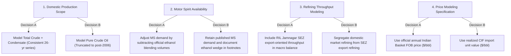

# Phase 7: Data Limitations, Remaining Uncertainties, and Open Research Questions

**Project Title:** *India's Petroleum Supply Chain and Import Exposure: A Historical Analysis of Domestic Production, Refinery Throughput, Petroleum Product Trade and Consumption*  
**Research Phase:** Phase 7 — Official Source Verification, Cross-Validation, and Discrepancy Resolution  

---

## 1. Overview & Objective

This document consolidates the boundary constraints, empirical limitations, unresolved reporting discrepancies, and strategic researcher decisions identified during Phase 7 source verification. 

Academic rigor requires that every data boundary and reporting nuance is made transparent prior to econometric modeling, causal inference, and paper drafting.

---

## 2. Documented Data Limitations & Boundary Constraints

### 2.1 Lease Condensate in Domestic Crude Oil Production Time Series
- **Observation:** PPAC reported domestic crude oil production includes lease condensate. From FY 2006-07 onwards, PPAC began reporting condensate as an identifiable line item (e.g., in FY 2023-24, pure crude oil was 27.168 MMT and condensate was 2.188 MMT, giving a total of 29.356 MMT). Prior to FY 2006-07, condensate was commingled within company crude totals.
- **Data Limitation:** Time series comparisons spanning pre-2006 and post-2006 horizons cannot isolate pure crude oil from lease condensate in earlier decades without external estimation models.
- **Empirical Impact:** Using the aggregate series slightly overstates pure crude production by 7% to 8% relative to strictly defined crude oil, but correctly represents total indigenous liquid feedstocks available to domestic refineries.

### 2.2 Ethanol Blending Distortions in Motor Spirit (MS) Availability Residuals
- **Observation:** India's national ethanol blending program expanded rapidly from under 2% in FY 2013-14 to over 12% in FY 2023-24 (and targeting 20% by FY 2025-26). Bio-ethanol is blended into motor gasoline at oil marketing company supply depots after refinery dispatch.
- **Data Limitation:** Refinery production workbooks record pure petroleum motor spirit output (refinery gate), while published consumption workbooks record finished blended motor fuel sold at retail outlets.
- **Empirical Impact:** Product availability residuals ($\text{Production} + \text{Imports} - \text{Exports} - \text{Consumption}$) for motor spirit exhibit an apparent structural deficit (consumption exceeding refinery output + net imports). This residual does not represent inventory drawdowns; it reflects the physical addition of non-petroleum bio-ethanol.

### 2.3 Structural Accounting Wedge in National Petroleum Product Consumption
- **Observation:** National petroleum product consumption in PPAC historical master series exceeds the direct retail sales tallies of public sector oil marketing companies (OMCs).
- **Data Limitation:** The difference is accounted for by:
  1. Direct imports of petroleum products by private industrial consumers (reported through DGCIS customs filings).
  2. Direct sales into the Domestic Tariff Area (DTA) by Reliance Jamnagar SEZ refinery, which are treated as imports under customs law but captured in domestic consumption.
- **Empirical Impact:** OMC retail dispatches cannot be used as a 1:1 substitute for total national consumption demand, particularly for industrial fuels such as fuel oil, petcoke, and naphtha.

### 2.4 Volume Weighting vs Arithmetic Averages in Indian Basket FOB Prices
- **Observation:** The official annual Indian Basket crude price is an intra-year daily volume-weighted average of Oman/Dubai sour crude and Brent sweet crude procurement.
- **Data Limitation:** The project's fortnightly under-recoveries dataset provides unweighted fortnightly price postings.
- **Empirical Impact:** The unweighted arithmetic average differs from the official annual published basket price by 0.05% to 1.84%. While this proves exceptional consistency, the official annual published series must remain the authoritative benchmark for econometric price regressions.

### 2.5 Unit Value CIF Wedges vs Pure Spot Market Prices
- **Observation:** Realized import unit values (USD/MT and USD/bbl) derived from total import expenditure and physical import quantities capture freight, insurance, crude grade quality differentials, and long-term term-contract pricing formulas.
- **Data Limitation:** Realized import unit values do not equal pure FOB spot benchmark prices (such as Brent or the Indian Basket FOB quote).
- **Empirical Impact:** The spread between realized import unit values and the Indian Basket FOB price represents a delivered CIF wedge plus crude quality adjustments, not price mismeasurement.

---

## 3. Recommended Data Corrections and Baseline Selections

Based on the verified evidence from original sources, the following standardized baseline rules are formally recommended for subsequent research phases:

| Data Area | Identified Issue | Primary Evidence | Recommended Baseline Selection | Research Paper Justification |
|:---|:---|:---|:---|:---|
| **FY 2025-26 Product Consumption** | Provisional workbook reports 243,202 TMT; state sales report 241,613 TMT; RE PDF reports 244,002 TMT. | `1773137026_Revised Estimates FY 2025-26_Combined.pdf` (Page 1) | **Adopt 244,002 TMT as preferred benchmark.** | Official PPAC published forward demand benchmark; eliminates provisional reporting lag. |
| **Crude Production Reporting** | Pre-2006 commingled condensate vs post-2006 separated condensate. | `1717395338_PT_Crude_oil_production_H.xls` (Row 19 footnote) | **Maintain Total (Crude + Condensate) as primary time series;** report pure crude as secondary. | Preserves consistent 26-year time series definition while qualifying condensate inclusion. |
| **FY 2026-27 Processing Throughput** | First quarter observation (65,695 TMT) present in `.xls` release. | `1788266304_PT_crude_processing_H.xls` (PT_CRUDE_H) | **Flag as partial-year (Till June) and exclude from annual CAGR.** | Prevents annualizing seasonal quarterly refinery maintenance schedules. |
| **Product Trade Slate Classification** | Direct private imports reported separately from OMC imports. | `1787315734_ICR_July 26.pdf` (Page 8 footnote) | **Maintain macro product import total (including DGCIS private imports).** | Accurately captures total national physical import exposure. |

---

## 4. Prioritized List of Open Questions Requiring Researcher Decisions

Prior to undertaking causal modeling, regression analysis, and paper drafting in Phase 8, the following strategic decisions must be confirmed by the research team:

### Priority 1: Domestic Crude Oil Series Selection for Econometric Supply Models
- **Decision Choice:**
  - *Option 1A (Recommended):* Utilize the aggregate `Total (Crude oil + condensate)` series (29.36 MMT in FY24) across the entire 1998–2024 horizon, adding an explicit methodological caveat that lease condensate is included throughout.
  - *Option 1B:* Split the time series into pure crude oil (27.17 MMT in FY24) for post-2006 analysis, and use estimated condensate shares for pre-2006 periods.
- **Trade-off:** Option 1A maintains unbroken institutional continuity with PPAC published time series, whereas Option 1B isolates strict geological crude extraction at the cost of artificial pre-2006 estimation.

### Priority 2: Treatment of Bio-Ethanol Blending in Gasoline Demand Accounting
- **Decision Choice:**
  - *Option 2A (Recommended):* Retain published retail motor spirit consumption as the official measure of consumer transportation fuel demand, while explicitly documenting that the apparent domestic supply deficit is filled by ~12–15% depot-level bio-ethanol blending.
  - *Option 2B:* Construct a "Pure Petroleum Motor Spirit Equivalent" consumption series by subtracting estimated bio-ethanol volumes from retail gasoline sales.
- **Trade-off:** Option 2A accurately tracks downstream transport fuel consumption, while Option 2B aligns strictly with refinery-gate petroleum mass balances.

### Priority 3: Separation of SEZ Merchant Refining from Domestic Supply Chain
- **Decision Choice:**
  - *Option 3A (Recommended):* Model India as an integrated macro refining hub, including both domestic tariff area (DTA) and Special Economic Zone (SEZ) throughput and exports, while isolating the domestic consumption balance.
  - *Option 3B:* Mathematically exclude RIL Jamnagar SEZ refinery throughput and commercial exports from the national supply chain to assess indigenous self-sufficiency purely for domestic demand.
- **Trade-off:** Option 3A reflects India's global trading reality (huge crude importer and product exporter), while Option 3B provides an autarkic view of domestic energy vulnerability.

### Priority 4: Selection of Benchmark Crude Price in Import Cost Econometrics
- **Decision Choice:**
  - *Option 4A (Recommended):* Employ realized CIF import unit values (USD/MT and USD/bbl) for import expenditure decomposition and trade value modeling, and employ the official Indian Basket FOB price for international market pass-through analysis.
  - *Option 4B:* Exclusively employ the Indian Basket FOB price as a single proxy for both physical procurement costs and trade expenditure.
- **Trade-off:** Option 4A preserves the true realized financial expenditures incurred by Indian refiners (including freight and crude sourness premiums), whereas Option 4B relies on a theoretical FOB price basket.

---

## 5. Methodological Safeguards for Research Paper Writing

In accordance with Phase 7 requirements, the research paper drafting process (Phase 8) must strictly enforce the following interpretation safeguards:

1. **No Conflation of Domestic Production Ratio with Capacity Utilization:** The ratio of domestic crude oil production to refinery crude processing ($\approx 11.2\%$ in FY24) must strictly be described as an *indigenous crude coverage ratio*. It must never be termed "refinery capacity utilization" (which measures throughput relative to installed nameplate capacity and exceeds 100% in Indian refineries).
2. **Clear Labeling of Import Dependence Proxy:** The constructed import-dependence proxy ($\frac{\text{Net Crude Imports}}{\text{Domestic Production} + \text{Net Imports}} \times 100 \approx 88.9\%$ in FY24) must be clearly designated as an *analytical physical supply balance proxy*, distinguishing it from MoPNG's official consumption-based import dependence formula.
3. **Apparent Availability Residuals Are Not Official Inventory Changes:** Residuals between production, net trade, and consumption must be interpreted as *unmeasured supply wedges* (reflecting depot stock changes, transit losses, direct private imports, and non-refinery blending components), not as audited corporate inventory disclosures.
4. **Descriptive Decompositions Do Not Imply Econometric Causality:** Arithmetic decompositions of import expenditure into volume and unit-value components are descriptive accounting identities; they do not establish causal macroeconomic transmission mechanisms.
