# Phase 7: Official Source Verification, Cross-Validation, and Discrepancy Resolution Plan

## 1. Executive Summary & Objective

This document defines the formal validation plan for Phase 7 of the academic research project:
**"India's Petroleum Supply Chain and Import Exposure: A Historical Analysis of Domestic Production, Refinery Throughput, Petroleum Product Trade and Consumption."**

The primary objective of Phase 7 is to conduct an independent, systematic, and reproducible validation of all core datasets, product-level time series, derived indicators, and empirical findings developed in Phases 2 through 6 against authoritative official sources available within the project repository.

Phase 7 enforces strict methodological separation between:
1. **Directly observed official records** (primary government publications, PPAC statistical time series, MoPNG reports).
2. **Re-aggregated and standardized datasets** (Phases 2 and 3 clean panels).
3. **Derived indicators and analytical calculations** (Phases 4, 5, and 6 statistical models, decompositions, and ratios).
4. **Substantive interpretations and research conclusions**.

In accordance with the Completion Gate guidelines, **no data in `01_Original_Data` will be modified or overwritten**, and no Phase 8 paper drafting will begin without explicit review and approval.

---

## 2. Inventory of Available Verification Sources

The project repository contains 33 original files in `01_Original_Data`, including long-run historical time series, independent monthly reporting workbooks, state-wise sales dispatches, retail and international pricing files, and official PDF publications.

| Source ID | Filename | Publisher & Document Type | Reporting Period | Verification Role in Phase 7 |
|:---|:---|:---|:---|:---|
| **VER-01** | `1788266304_PT_crude_processing_H.xls` | PPAC, MoPNG (Historical & Monthly Workbook) | FY 1998-99 to 2025-26, plus 17 monthly sheets (2010-11 to 2025-26) | Independent cross-verification for Refinery Crude Processing, company-wise throughput, and month-by-month reconciliation. |
| **VER-02** | `1729493890_pt_import_en.xlsx` | PPAC, MoPNG (Monthly Trade Quantities) | FY 2023-24 (April to March) | Independent monthly sum validation for crude oil and petroleum product import and export physical quantities. |
| **VER-03** | `1729493957_val-in-dollar_en.xlsx` | PPAC, MoPNG (Monthly Trade Values) | FY 2023-24 (April to March) | Independent monthly sum validation for crude oil and product trade values in Million US$. |
| **VER-04** | `1751966513_val-in-dollar-en.xlsx` | PPAC, MoPNG (Monthly Trade Values) | FY 2024-25 (April to March) | Independent monthly sum validation for FY 2024-25 trade values in Million US$. |
| **VER-05** | `1784609810_PT_IMPORT_VAL_US$_25-26.xlsx` | PPAC, MoPNG (Monthly Trade Values) | FY 2025-26 (Monthly) | Cross-check of recent monthly value submissions in Million US$. |
| **VER-06** | `1787119859_PT_Import_Val_USD.xls` | PPAC, MoPNG (Monthly Trade Values) | FY 2026-27 (Apr-Jul) | Monitoring recent trade value filings. |
| **VER-07** | `1787137273_Statewise_Sales-POL_Consumption_Final.xlsx` | PPAC, MoPNG (State-wise Dispatches) | FY 2008-09 to FY 2025-26 | Cross-verification of national petroleum product consumption against the sum of state and regional sales dispatches. |
| **VER-08** | `1761715894_petroleum-prices-and-under-recoveries.xlsx` | PPAC, MoPNG (Fortnightly Pricing & Subsidies) | Fortnightly from 2011 to 2022 | Independent validation of Indian Basket FOB prices ($/bbl, Rs./bbl), RBI exchange rates, and OMC under-recoveries. |
| **VER-09** | `1773137026_Revised Estimates FY 2025-26_Combined.pdf` | PPAC, MoPNG (Official Demand Forecast / RE) | FY 2025-26 | Authoritative forward benchmark for domestic petroleum product consumption demand by product and region. |
| **VER-10** | `1787315734_ICR_July 26.pdf` | PPAC, MoPNG (Industry Consumption Report) | July 2026 & FY 2022-26 Trends | Authoritative source for official MT-to-barrel conversion factors (Table 9), DGCIS private import inclusion methodology, and recent consumption trends (Table 10). |
| **VER-11** | `1788266780_Flash_Report_WEB_UPLOAD_Aug26.pdf` | PPAC, MoPNG (Monthly Flash Report) | August 2026 & Cumulative FY 2026-27 | Benchmark for recent monthly consumption figures, ethanol blending disclosure, and provisional adjustments. |
| **VER-12** | `04_Analysis/phase3/graph_and_report_reference_catalogue.csv` | PPAC / MoPNG Published Figures & Tables | 50 inventoried official exhibits | Visual and contextual validation against published official charts, definitions, and slide decks. |

---

## 3. Prioritized Validation Matrix (10 Core Variables)

The validation plan establishes rigorous check criteria across the 10 priority supply chain variables identified in the research brief.

```mermaid
flowchart TD
    subgraph Primary_Sources["Primary Standardized Datasets (Phases 2-6)"]
        A1["1. Domestic Crude Production"]
        A2["2. Refinery Crude Throughput"]
        A3["3. Crude Oil Import Quantity"]
        A4["4. Product Imports & Exports"]
        A5["5. Product Production"]
        A6["6. Product Consumption / Sales"]
        A7["7. Import Value (Rs. Crore)"]
        A8["8. Import Value (Million USD)"]
        A9["9. Indian Basket Price ($/bbl)"]
        A10["10. Derived Supply-Chain Indicators"]
    end

    subgraph Independent_Verification["Independent Verification Records"]
        B1["Foundation Day Report & Monthly Flash"]
        B2["PT_crude_processing_H.xls & 17 Monthwise Sheets"]
        B3["pt_import_en.xlsx (FY24 Monthly Sum)"]
        B4["Monthly Product Trade Sums & SEZ Checks"]
        B5["Mass Balance & Processing Gain vs Throughput"]
        B6["Statewise Sales, RE FY26 PDF, ICR Table 10"]
        B7["RBI Implied FX Conversion from Under-Recoveries"]
        B8["Monthly Dollar Files (FY24, FY25, FY26)"]
        B9["Fortnightly Prices & FX in Under-Recoveries"]
        B10["Independent Re-implementation & Hand Audits"]
    end

    A1 -->|Cross-Check| B1
    A2 -->|Cross-Check| B2
    A3 -->|Cross-Check| B3
    A4 -->|Cross-Check| B4
    A5 -->|Cross-Check| B5
    A6 -->|Cross-Check| B6
    A7 -->|Cross-Check| B7
    A8 -->|Cross-Check| B8
    A9 -->|Cross-Check| B9
    A10 -->|Cross-Check| B10
```

### Detailed Protocol by Variable

#### 1. Domestic Crude Oil Production
- **Dataset & Field Checked:** `core_annual_petroleum_dataset.csv` (`domestic_crude_production`, `domestic_crude_production_mmt`), `annual_crude_oil_production.csv`.
- **Original Source:** `1717395338_PT_Crude_oil_production_H.xls` (PSU, JV/Private, Offshore vs Onshore).
- **Independent Verification Source:** PPAC Foundation Day Report (`1748348757...pdf`), PPAC Flash Report (`1788266780...pdf`), MoPNG annual reports, and reference catalogue entries.
- **Reporting Period & Units:** FY 1998-99 to FY 2023-24 (P); Thousand Metric Tonnes (TMT) and Million Metric Tonnes (MMT).
- **Comparison Method:** Direct annual level comparison, YoY growth verification, ONGC vs OIL vs Private/JV sub-total cross-sums.
- **Expected Comparability:** Identical (0% tolerance, allowing for rounding to 1 decimal place in MMT).
- **Known Scope Nuance:** Domestic crude oil figures in PPAC publications include lease condensate.

#### 2. Refinery Crude Oil Processing / Throughput
- **Dataset & Field Checked:** `core_annual_petroleum_dataset.csv` (`refinery_crude_processing`, `refinery_crude_processing_mmt`), `annual_refinery_crude_processing.csv`, `annual_refinery_crude_processing_detailed.csv`.
- **Original Source:** `1761642861_PT_refinery_crude_processing_H.xlsx`.
- **Independent Verification Source:** `1788266304_PT_crude_processing_H.xls` (Independent `.xls` release with coverage through FY 2025-26 and 17 monthly sheets).
- **Reporting Period & Units:** FY 1998-99 to FY 2025-26; TMT and MMT.
- **Comparison Method:** Complete cell-by-cell matrix alignment across 23 refineries and 28 fiscal years; comparison of historical revisions between the `.xlsx` and `.xls` editions.
- **Expected Comparability:** Identical across settled historical years; provisional years tested for revision adjustments.
- **Known Scope Nuance:** Distinguishes PSU/JV refineries from Private sector (Reliance Jamnagar DTA + SEZ, Nayara Vadinar).

#### 3. Crude Oil Import Quantity
- **Dataset & Field Checked:** `core_annual_petroleum_dataset.csv` (`crude_import_quantity`, `crude_import_quantity_mmt`), `annual_petroleum_trade_volumes.csv`, `import_quantity_value_aligned_dataset.csv`.
- **Original Source:** `1751964547_PT_IMPORT_TMT_H.xlsx`.
- **Independent Verification Source:** `1729493890_pt_import_en.xlsx` (Monthly Crude Import quantities for FY 2023-24: April through March).
- **Reporting Period & Units:** FY 1998-99 to FY 2024-25; TMT and MMT.
- **Comparison Method:** Sum of 12 individual monthly import dispatches compared to the reported FY 2023-24 annual total in the historical time series.
- **Expected Comparability:** Identical (tolerance < 0.05% due to monthly provisional revisions).

#### 4. Petroleum Product Imports and Exports
- **Dataset & Field Checked:** `product_imports_dataset.csv`, `product_exports_dataset.csv`, `core_annual_petroleum_dataset.csv` (`petroleum_product_imports`, `petroleum_product_exports`).
- **Original Source:** `1751964547_PT_IMPORT_TMT_H.xlsx`.
- **Independent Verification Source:** `1729493890_pt_import_en.xlsx` (Monthly dispatches by product: LPG, MS, HSD, ATF, Naphtha, FO, Bitumen, Lubes).
- **Reporting Period & Units:** FY 1998-99 to FY 2024-25; TMT.
- **Comparison Method:** Monthly product-by-product sum vs annual total; verification that SEZ commercial product exports are captured in national export totals.
- **Expected Comparability:** High agreement across major commercial products; examine DGCIS direct private import treatment.

#### 5. Petroleum Product Production
- **Dataset & Field Checked:** `product_production_dataset.csv`, `core_annual_petroleum_dataset.csv` (`petroleum_product_production`), `annual_petroleum_product_production.csv`.
- **Original Source:** `1761642701_PT_production_product_H.xls`.
- **Independent Verification Source:** Mass-balance verification against refinery throughput (`refinery_crude_processing`), official conversion factors (ICR Table 9), and reference catalogue exhibits.
- **Reporting Period & Units:** FY 1998-99 to FY 2024-25; TMT and MMT.
- **Comparison Method:** Product slate aggregations (LPG, Mogas, Naphtha, ATF, HSD, FO/LSHS, Bitumen, Petcoke, Others) and calculation of implied refinery expansion gain. Implied yield must stay within physical chemical bounds (105%–108% of throughput).
- **Expected Comparability:** Yield ratio consistency check; product totals verified against fractionator dispatches.

#### 6. Petroleum Product Consumption / Market Demand
- **Dataset & Field Checked:** `product_consumption_dataset.csv`, `core_annual_petroleum_dataset.csv` (`petroleum_product_consumption`), `annual_petroleum_product_consumption.csv`.
- **Original Source:** `1788343376_PT_Consumption_English.xls`.
- **Independent Verification Source:**
  1. `1787137273_Statewise_Sales-POL_Consumption_Final.xlsx` (All-India state dispatches 2008-09 to 2025-26).
  2. `1773137026_Revised Estimates FY 2025-26_Combined.pdf` (PPAC RE 2025-26 official benchmark).
  3. `1787315734_ICR_July 26.pdf` (Table-10 Consumption Trend in MMT).
  4. `1788266780_Flash_Report_WEB_UPLOAD_Aug26.pdf` (Monthly flash dispatches).
- **Reporting Period & Units:** FY 1997-98 to FY 2025-26; TMT and MMT.
- **Comparison Method:** Multi-source reconciliation: Compare national historical consumption against the sum of state-level dispatches; verify FY 2025-26 against RE benchmark; cross-check ICR Table 10 annual series.
- **Expected Comparability:** High concordance; document structural reasons for any delta between sales dispatches and consumption (e.g., DGCIS private imports, RIL SEZ DTA sales, ethanol blending).

#### 7. Petroleum Import Value in Indian Rupees (Rs. Crore)
- **Dataset & Field Checked:** `import_value_dataset.csv`, `core_annual_petroleum_dataset.csv` (`crude_import_value_rs_crore`, `product_import_val_inr_crore`, `total_import_val_inr_crore`).
- **Original Source:** `1751964598_PT_IMPORT_VAL_RS.CRS._H.xlsx`.
- **Independent Verification Source:** Derived from USD import values (`1751964622...`) multiplied by official RBI annual average exchange rates from `1761715894_petroleum-prices-and-under-recoveries.xlsx`.
- **Reporting Period & Units:** FY 1998-99 to FY 2024-25; Rs. Crore.
- **Comparison Method:** Implied annual exchange rate calculation (`Value_INR / Value_USD`) compared with official RBI annual reference rates.
- **Expected Comparability:** Implied rate must align within transaction-timing band of official RBI annual average.

#### 8. Petroleum Import Value in US Dollars (Million US$)
- **Dataset & Field Checked:** `import_value_dataset.csv`, `core_annual_petroleum_dataset.csv` (`crude_import_val_usd_million`, `product_import_val_usd_million`, `total_import_val_usd_million`).
- **Original Source:** `1751964622_PT_IMPORT_VAL_US$_H.xlsx`.
- **Independent Verification Source:**
  1. `1729493957_val-in-dollar_en.xlsx` (Monthly sum for FY 2023-24).
  2. `1751966513_val-in-dollar-en.xlsx` (Monthly sum for FY 2024-25).
  3. `1784609810_PT_IMPORT_VAL_US$_25-26.xlsx` (Monthly data for FY 2025-26).
- **Reporting Period & Units:** FY 1998-99 to FY 2024-25; Million US$.
- **Comparison Method:** Sum of 12 monthly value entries compared with the reported fiscal year total in the historical master file.
- **Expected Comparability:** Identical or within small monthly revision tolerances (< 0.1%).

#### 9. Indian Basket Crude Oil FOB Price
- **Dataset & Field Checked:** `indian_basket_price_series.csv`, `crude_oil_fob_price_indian_basket.csv`, `core_annual_petroleum_dataset.csv` (`crude_price`).
- **Original Source:** `1775133106_PP_Crude-Oil-FOB-Price-(Indian Basket)-Historical.xlsx`.
- **Independent Verification Source:** `1761715894_petroleum-prices-and-under-recoveries.xlsx` (Fortnightly Indian Basket prices in $/bbl and Rs./bbl from 2011 to 2022).
- **Reporting Period & Units:** FY 1997-98 to FY 2024-25; USD/bbl and INR/bbl.
- **Comparison Method:** Calculate annual arithmetic and volume-weighted averages from the 24 fortnightly observations per fiscal year and compare to the official reported annual Indian Basket price.
- **Expected Comparability:** Implied annual average matches within standard trading day / volume weighting variance (< 1.5%).

#### 10. Derived Supply-Chain Indicators & Methodological Formulas
- **Dataset & Field Checked:** `derived_indicators.csv`, `import_unit_values.csv`, `import_expenditure_decomposition.csv`, `product_trade_balance.csv`, `apparent_product_availability_residual.csv`.
- **Indicators Audited:**
  1. *Net Crude Imports:* $\text{Crude Imports} - \text{Crude Exports}$.
  2. *Crude Import Dependence Proxy:* $\frac{\text{Net Crude Imports}}{\text{Refinery Throughput}} \times 100$.
  3. *Production-to-Throughput Ratio:* $\frac{\text{Domestic Crude Production}}{\text{Refinery Throughput}} \times 100$.
  4. *Crude Import Unit Value:* $\frac{\text{Crude Import Value (USD)}}{\text{Crude Import Quantity (MT)}} \times \text{bbl-conversion factor}$.
  5. *Product Trade Balances:* $\text{Product Exports} - \text{Product Imports}$.
  6. *Apparent Product Availability Residual:* $\text{Production} + \text{Imports} - \text{Exports} - \text{Consumption}$.
  7. *Import Expenditure Decompositions:* LMDI log-mean weight volume vs price contributions.
  8. *YoY Growth & Compound Annual Growth Rates (CAGR):* $\left(\frac{V_T}{V_0}\right)^{1/n} - 1$.
- **Verification Method:** Complete independent programmatic re-calculation from scratch using clean math routines, verified against hand-calculated benchmark checks for selected reference years (FY 1998-99, FY 2005-06, FY 2013-14, FY 2019-20, FY 2023-24).
- **Acceptance Criteria:** Exact mathematical equivalence (0.00% formula divergence).

---

## 4. Evidence Classification Standards

Every variable, sub-period, and comparison entry will be assigned an official validation status adhering strictly to the required Phase 7 taxonomy:

| Status Code | Status Name | Formal Definition |
|:---|:---|:---|
| **V** | **Verified** | Independently agrees with official verification source within established rounding tolerance ($\le 0.1\%$). |
| **VQ** | **Verified with qualification** | Generally agrees, but has documented scope, classification, or reporting boundary limitations (e.g., inclusion of condensate, ethanol blending, SEZ DTA sales). |
| **PV** | **Partially verified** | Confirmed for specific historical sub-periods or definitions, but full time-series verification is limited by source availability. |
| **UD** | **Unresolved discrepancy** | Comparable official sources disagree and the divergence cannot be accounted for by known revisions or methodological differences. |
| **NIV** | **Not independently verifiable** | No second, independent official primary source exists within the available project documents. |
| **NC** | **Not comparable** | Incompatible definitions, reporting cut-offs, or physical boundary rules prevent a valid direct comparison. |

---

## 5. Execution Workflow & Output Deliverables

The Phase 7 pipeline will execute sequentially:

1. **Step 1:** Establish validation plan (`phase7_validation_plan.md`) — *Completed*.
2. **Step 2:** Develop reproducible verification script (`phase7_source_verification.py`) in `04_Analysis/phase7/scripts/`.
3. **Step 3:** Execute script, stream execution logs to `04_Analysis/phase7/logs/phase7_validation.log`, and generate all 5 required CSV deliverables:
   - `cross_source_comparison.csv`
   - `variable_validation_status.csv`
   - `discrepancy_register.csv`
   - `derived_indicator_audit.csv`
   - `official_report_comparison.csv`
4. **Step 4:** Compile comprehensive narrative reports:
   - `phase7_validation_report.md`
   - `phase7_limitations_and_open_questions.md`
   - `phase7_completion_checklist.md`
5. **Step 5:** Review all deliverables against the Completion Gate and await explicit user approval before proceeding to Phase 8.
