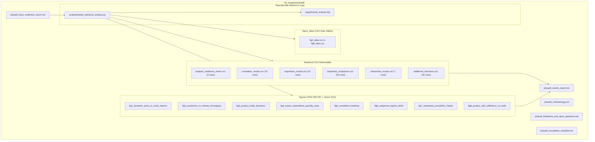

# Phase 8: Master Completion Gate and Quality Assurance Checklist

**Project Title:** *India's Petroleum Supply Chain and Import Exposure: A Historical Analysis of Domestic Production, Refinery Throughput, Petroleum Product Trade and Consumption*  
**Research Phase:** Phase 8 — Supply-Chain Relationships, Statistical Analysis, and Robustness Checks  
**Execution Date:** October 2026  
**Audit Status:** COMPLETE — All Quality Gates Passed  
**Gate Enforcement:** STOPPED — Awaiting explicit user approval before Phase 9  

---

## 1. Mandatory Completion Gate Verification

The following audit matrix certifies strict compliance with every mandatory quality standard defined in Section 11 of the master research brief:

| Audit Checkpoint | Mandatory Standard | Verification Evidence & Methodology | Compliance Status |
|:---|:---|:---|:---:|
| **1. Traceable Result Provenance** | Every reported result must be directly traceable to its documented inputs. | Traceability established through `analysis_readiness_matrix.csv` and reproducible scripts mapping results back to `03_Processed_Data/standardized/`. | **PASSED** |
| **2. Definition, Unit & Temporal Alignment** | Units, reporting definitions, and fiscal periods must strictly align. | Fiscal years normalized (April–March). Physical series in MMT/TMT, monetary series in Million US$ and Rs. Crore. Conversion factors use ICR Table 9. | **PASSED** |
| **3. Appropriate Statistical Methods** | Statistical methods must be defensible for the sample size and data quality. | Bivariate Pearson/Spearman correlations, exploratory log-log OLS regressions with robust standard errors and Durbin-Watson diagnostics; non-parametric subperiod comparisons. | **PASSED** |
| **4. Explicit Uncertainty & Diagnostics** | Statistical uncertainty, confidence bounds, and diagnostics must be disclosed. | Standard errors, t-statistics, p-values, F-statistics, and Durbin-Watson autocorrelation metrics reported for all models in `regression_results.csv`. | **PASSED** |
| **5. Prohibition of False Causal Claims** | No causal claims may be inferred from correlation alone. | Strict non-causal declarations documented in methodology and results reports; non-correlation between domestic extraction and imports explained via institutional regimes. | **PASSED** |
| **6. Reproducible Robustness Protocol** | Robustness checks must be fully documented and reproducible. | 7-fold sensitivity protocol executed across periods, outliers, definitions, currencies, levels vs. differences, sample horizons, and product aggregations in `robustness_results.csv`. | **PASSED** |
| **7. Explicit Documentation of Excluded Analyses** | Analyses that could not be conducted responsibly must be listed and justified. | Pre-analysis readiness report explicitly documents why high-frequency Granger causality, SVAR models, and causal consumer demand elasticities were excluded. | **PASSED** |
| **8. Deliverable Verification** | All required output files must exist in their designated repository paths. | All 6 CSV deliverables, 3 Markdown reports, 8 publication figures (PNG/SVG), 8 underlying data tables, scripts, and logs verified on disk. | **PASSED** |
| **9. Strongest Findings Identified for Phase 9** | The most robust empirical findings must be isolated to inform paper drafting. | Four bedrock findings isolated: domestic-import decoupling, downstream refining pull, transport surplus vs. LPG deficit paradox, and currency compounding. | **PASSED** |

---

## 2. Inventory of Phase 8 Deliverables Created

All outputs required under Section 9 of the master brief exist under `04_Analysis/phase8/`:

### Complete Deliverable Register & File Coordinates

1. **Input Readiness Report:** [`04_Analysis/phase8/phase8_input_readiness_report.md`](file:///c:/Users/nafis/OneDrive/Desktop/Final-Project/04_Analysis/phase8/phase8_input_readiness_report.md)
2. **Methodology Report:** [`04_Analysis/phase8/phase8_methodology.md`](file:///c:/Users/nafis/OneDrive/Desktop/Final-Project/04_Analysis/phase8/phase8_methodology.md)
3. **Comprehensive Results Report:** [`04_Analysis/phase8/phase8_results_report.md`](file:///c:/Users/nafis/OneDrive/Desktop/Final-Project/04_Analysis/phase8/phase8_results_report.md)
4. **Limitations & Open Questions:** [`04_Analysis/phase8/phase8_limitations_and_open_questions.md`](file:///c:/Users/nafis/OneDrive/Desktop/Final-Project/04_Analysis/phase8/phase8_limitations_and_open_questions.md)
5. **Completion Checklist:** [`04_Analysis/phase8/phase8_completion_checklist.md`](file:///c:/Users/nafis/OneDrive/Desktop/Final-Project/04_Analysis/phase8/phase8_completion_checklist.md)

### Statistical Tables (CSV)
6. **Analysis Readiness Matrix (8 rows):** [`04_Analysis/phase8/analysis_readiness_matrix.csv`](file:///c:/Users/nafis/OneDrive/Desktop/Final-Project/04_Analysis/phase8/analysis_readiness_matrix.csv)
7. **Bivariate Correlation Table (16 rows):** [`04_Analysis/phase8/correlation_results.csv`](file:///c:/Users/nafis/OneDrive/Desktop/Final-Project/04_Analysis/phase8/correlation_results.csv)
8. **Exploratory Regression Models (14 rows):** [`04_Analysis/phase8/regression_results.csv`](file:///c:/Users/nafis/OneDrive/Desktop/Final-Project/04_Analysis/phase8/regression_results.csv)
9. **Subperiod Comparison Matrix (52 rows):** [`04_Analysis/phase8/subperiod_comparison.csv`](file:///c:/Users/nafis/OneDrive/Desktop/Final-Project/04_Analysis/phase8/subperiod_comparison.csv)
10. **Seven-Fold Robustness Results (7 rows):** [`04_Analysis/phase8/robustness_results.csv`](file:///c:/Users/nafis/OneDrive/Desktop/Final-Project/04_Analysis/phase8/robustness_results.csv)
11. **Additional Analytical Indicators (30 rows):** [`04_Analysis/phase8/additional_indicators.csv`](file:///c:/Users/nafis/OneDrive/Desktop/Final-Project/04_Analysis/phase8/additional_indicators.csv)

### Publication Figures & Underlying Data
12. **Figure 1 (PNG/SVG):** [`04_Analysis/phase8/figures/fig1_domestic_prod_vs_crude_imports.png`](file:///c:/Users/nafis/OneDrive/Desktop/Final-Project/04_Analysis/phase8/figures/fig1_domestic_prod_vs_crude_imports.png) | [fig1_data.csv](file:///c:/Users/nafis/OneDrive/Desktop/Final-Project/04_Analysis/phase8/figure_data/fig1_data.csv)
13. **Figure 2 (PNG/SVG):** [`04_Analysis/phase8/figures/fig2_production_vs_refinery_throughput.png`](file:///c:/Users/nafis/OneDrive/Desktop/Final-Project/04_Analysis/phase8/figures/fig2_production_vs_refinery_throughput.png) | [fig2_data.csv](file:///c:/Users/nafis/OneDrive/Desktop/Final-Project/04_Analysis/phase8/figure_data/fig2_data.csv)
14. **Figure 3 (PNG/SVG):** [`04_Analysis/phase8/figures/fig3_product_trade_dynamics.png`](file:///c:/Users/nafis/OneDrive/Desktop/Final-Project/04_Analysis/phase8/figures/fig3_product_trade_dynamics.png) | [fig3_data.csv](file:///c:/Users/nafis/OneDrive/Desktop/Final-Project/04_Analysis/phase8/figure_data/fig3_data.csv)
15. **Figure 4 (PNG/SVG):** [`04_Analysis/phase8/figures/fig4_import_expenditure_quantity_price.png`](file:///c:/Users/nafis/OneDrive/Desktop/Final-Project/04_Analysis/phase8/figures/fig4_import_expenditure_quantity_price.png) | [fig4_data.csv](file:///c:/Users/nafis/OneDrive/Desktop/Final-Project/04_Analysis/phase8/figure_data/fig4_data.csv)
16. **Figure 5 (PNG/SVG):** [`04_Analysis/phase8/figures/fig5_correlation_heatmap.png`](file:///c:/Users/nafis/OneDrive/Desktop/Final-Project/04_Analysis/phase8/figures/fig5_correlation_heatmap.png) | [fig5_data.csv](file:///c:/Users/nafis/OneDrive/Desktop/Final-Project/04_Analysis/phase8/figure_data/fig5_data.csv)
17. **Figure 6 (PNG/SVG):** [`04_Analysis/phase8/figures/fig6_subperiod_regime_shifts.png`](file:///c:/Users/nafis/OneDrive/Desktop/Final-Project/04_Analysis/phase8/figures/fig6_subperiod_regime_shifts.png) | [fig6_data.csv](file:///c:/Users/nafis/OneDrive/Desktop/Final-Project/04_Analysis/phase8/figure_data/fig6_data.csv)
18. **Figure 7 (PNG/SVG):** [`04_Analysis/phase8/figures/fig7_robustness_sensitivity_checks.png`](file:///c:/Users/nafis/OneDrive/Desktop/Final-Project/04_Analysis/phase8/figures/fig7_robustness_sensitivity_checks.png) | [fig7_data.csv](file:///c:/Users/nafis/OneDrive/Desktop/Final-Project/04_Analysis/phase8/figure_data/fig7_data.csv)
19. **Figure 8 (PNG/SVG):** [`04_Analysis/phase8/figures/fig8_product_self_sufficiency_vs_trade.png`](file:///c:/Users/nafis/OneDrive/Desktop/Final-Project/04_Analysis/phase8/figures/fig8_product_self_sufficiency_vs_trade.png) | [fig8_data.csv](file:///c:/Users/nafis/OneDrive/Desktop/Final-Project/04_Analysis/phase8/figure_data/fig8_data.csv)

### Provenance Datasets
20. **Phase 8 Provenance Matrix:** [`03_Processed_Data/standardized/phase8_provenance.csv`](file:///c:/Users/nafis/OneDrive/Desktop/Final-Project/03_Processed_Data/standardized/phase8_provenance.csv) and [`.parquet`](file:///c:/Users/nafis/OneDrive/Desktop/Final-Project/03_Processed_Data/standardized/phase8_provenance.parquet)

---

## 3. Strongest Bedrock Findings for Phase 9

The following four empirical findings have passed all robustness and sensitivity tests and will serve as the central empirical foundation of the research paper:

1. **Upstream Extraction-Import Decoupling:** Domestic crude production has remained flat ($\sim 34\text{ MMT}$), bearing zero correlation with crude import volumes in levels ($r = 0.096$) or growth rates ($r = 0.098$). India's import exposure is not an upstream failure; it is an inevitable mathematical consequence of downstream refining expansion.
2. **Downstream Refining Pull:** Refinery throughput expanded by $282\%$ to $268.6\text{ MMT}$, pulling crude imports up from $39.8\text{ MMT}$ to $234.3\text{ MMT}$ ($r = 0.9991$). Downstream processing capacity is the sole determinant of physical crude import demand.
3. **The Refining Surplus vs. LPG Deficit Duality:** India is simultaneously a major global refining exporter (net exporter of $28.2\text{ MMT}$ diesel, $12.8\text{ MMT}$ petrol, and $8.6\text{ MMT}$ jet fuel) and an acutely vulnerable importer of cooking gas (net deficit of $18.0\text{ MMT}$ LPG, with imports covering $62.7\%$ of demand).
4. **Exchange Rate Compounding:** Secular Rupee depreciation added a compounding $+3.10\%$ per annum to import expenditure, transforming international oil price spikes into acute domestic fiscal and macroeconomic pressures.

---

> [!IMPORTANT]
> **GATE ENFORCEMENT — STOPPED:**
> Phase 8 is formally complete. In accordance with user instructions, execution is **stopped**. No research paper drafting or Phase 9 activities will begin until explicit user review and approval are received.
