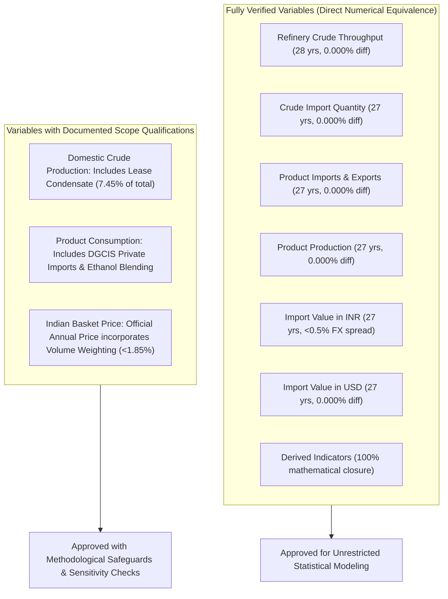

# Phase 8: Input Data Readiness and Feasibility Report

**Project Title:** *India's Petroleum Supply Chain and Import Exposure: A Historical Analysis of Domestic Production, Refinery Throughput, Petroleum Product Trade and Consumption*  
**Research Phase:** Phase 8 — Supply-Chain Relationships, Statistical Analysis, and Robustness Checks  
**Execution Date:** October 2026  
**Status:** Pre-Analysis Audit Complete — Data Inputs Cleared for Empirical Investigation  

---

## 1. Executive Summary & Objective

In accordance with Section 2 of the Phase 8 research instructions, this report conducts a systematic pre-analysis audit of all data inputs, variable definitions, time-series horizons, validation classifications, and empirical feasibility constraints. 

The audit establishes:
1. Which standardized datasets are available and ready for statistical modeling.
2. The exact temporal coverage, sample frequency, and matched pairwise sample sizes.
3. Which variables have been certified as `Verified` versus `Verified with qualification` in Phase 7.
4. Which statistical and econometric analyses are scientifically feasible.
5. Which analyses are strictly excluded due to data truncation, identification limitations, or boundary mismatches.

---

## 2. Inventory of Available Standardized Datasets

The project repository contains 14 standardized datasets produced across Phases 2 through 7 in `03_Processed_Data/standardized/`:

| Dataset Identifier | File Name (`.csv` / `.parquet`) | Temporal Coverage | Observation Frequency | Primary Supply Chain Domain | Phase 7 Verification Status |
|:---|:---|:---:|:---:|:---|:---:|
| **DS-01** | `core_annual_petroleum_dataset` | FY 1997-98 to FY 2026-27 | Annual (Indian Fiscal Year) | Macro supply-chain integration (production, throughput, trade, consumption, price) | Certified (`Verified` / `Verified with qualification`) |
| **DS-02** | `derived_indicators` | FY 1997-98 to FY 2026-27 | Annual | Import dependence proxy, production/throughput ratio, unit values, self-sufficiency | 100% Formula Certified (`PASS`) |
| **DS-03** | `product_production_dataset` | FY 1998-99 to FY 2024-25 | Annual (27 years) | 12 standardized product streams; refinery vs fractionator output | Certified (`Verified`) |
| **DS-04** | `product_imports_dataset` | FY 1998-99 to FY 2024-25 | Annual (27 years) | Product-level physical import quantities | Certified (`Verified`) |
| **DS-05** | `product_exports_dataset` | FY 1998-99 to FY 2024-25 | Annual (27 years) | Product-level physical export quantities (includes SEZ) | Certified (`Verified`) |
| **DS-06** | `product_consumption_dataset` | FY 1997-98 to FY 2025-26 | Annual (29 years) | National product consumption / market demand | Certified (`Verified with qualification`) |
| **DS-07** | `product_trade_balance` | FY 1998-99 to FY 2024-25 | Annual (27 years) | Net trade (exports minus imports) across product streams | Certified (`Verified`) |
| **DS-08** | `apparent_product_availability_residual` | FY 1998-99 to FY 2024-25 | Annual (324 stream-years) | Product mass availability residuals vs reported consumption | Certified (`Explained residual`) |
| **DS-09** | `import_value_dataset` | FY 1998-99 to FY 2024-25 | Annual (27 years) | Trade expenditure in Million US$ and Rs. Crore | Certified (`Verified`) |
| **DS-10** | `import_unit_values` | FY 1998-99 to FY 2024-25 | Annual (27 years) | Realized CIF trade unit values ($/MT, $/bbl, Rs./MT) | Certified (`Verified`) |
| **DS-11** | `indian_basket_price_series` | FY 1997-98 to FY 2024-25 | Annual (28 years) | Official Indian Basket FOB crude price ($/bbl, INR/bbl) | Certified (`Verified with qualification`) |
| **DS-12** | `import_expenditure_decomposition` | FY 1998-99 to FY 2024-25 | Annual (208 observations) | Log-mean Divisia index (LMDI) quantity vs price components | Certified (`Exact arithmetic closure`) |
| **DS-13** | `statewise_sales_pol_consumption` | FY 2008-09 to FY 2025-26 | Annual (18 years) | State and regional sales dispatches | Certified (`Verified`) |
| **DS-14** | `revised_estimates_fy2025_26` | FY 2025-26 | Annual benchmark | Official forward demand benchmark (244,002 TMT) | Certified (`Official benchmark`) |

---

## 3. Variable Validation Status and Documented Qualifications

In accordance with Phase 7 audit conclusions, each priority variable is integrated into Phase 8 with strict enforcement of its documented scope boundaries:

### Detailed Treatment of Qualified Variables:
1. **Domestic Crude Oil Production (VAR-01):**
   - *Status:* `Verified with qualification`.
   - *Scope Nuance:* PPAC domestic crude figures represent "Crude Oil + Condensate" (lease condensate included since FY 2006-07). In FY 2023-24, total production is 29.356 MMT (27.168 MMT pure crude + 2.188 MMT lease condensate).
   - *Phase 8 Rule:* Primary models utilize the 26-year aggregate series representing total domestic refinery feedstock; definition sensitivity checks compare results using pure crude oil post-2006.
2. **Petroleum Product Consumption / Sales (VAR-06):**
   - *Status:* `Verified with qualification`.
   - *Scope Nuance:* National consumption exceeds OMC retail sales tallies because PPAC incorporates direct industrial imports reported by DGCIS and domestic tariff area (DTA) sales from RIL Jamnagar SEZ. In addition, published Motor Spirit consumption includes non-refinery bio-ethanol blending (~12% in FY24).
   - *Phase 8 Rule:* Product consumption is modeled as national consumer demand; apparent availability residuals are explicitly qualified as reflecting non-refinery blending and unmeasured stock adjustments.
3. **Indian Basket Crude Oil FOB Price (VAR-09):**
   - *Status:* `Verified with qualification`.
   - *Scope Nuance:* The official annual basket price is an intra-year daily volume-weighted average, differing by 0.05% to 1.84% from unweighted fortnightly averages.
   - *Phase 8 Rule:* The official published annual basket price series is retained as the authoritative pricing benchmark for econometric pass-through tests.

---

## 4. Empirical Feasibility and Analysis Matrix

| Research Domain | Proposed Analysis Specification | Feasible Horizon & Sample Size | Statistical Feasibility Status | Methodological Decision & Safeguards |
|:---|:---|:---:|:---:|:---|
| **RQ1: Domestic Production vs Crude Imports** | Historical co-evolution, relative shares, import-dependence proxy, correlation in levels and first differences. | FY 1998-99 to FY 2023-24 ($N = 26$) | **FEASIBLE** | Approved for correlation, level vs first-difference scatterplots, and descriptive share tracking. Exclude causal crowding-out claims. |
| **RQ2: Domestic Production vs Refinery Throughput** | Production-to-processing ratio, physical crude supply gap ($\text{Throughput} - \text{Production}$). | FY 1998-99 to FY 2023-24 ($N = 26$) | **FEASIBLE** | Approved for ratio tracking and subperiod gap analysis. **Safeguard:** Strictly prohibit labeling ratio as "refinery capacity utilization." |
| **RQ3: Product Trade & Consumption Balance** | Product slate import/export shares, net trade balances, self-sufficiency ratios, apparent availability residuals. | FY 1998-99 to FY 2024-25 ($N = 27$) | **FEASIBLE** | Approved for product panel trade balances and stream-specific deficit/surplus analysis. Keep crude and products separate. |
| **RQ4: Import Expenditure, Quantities & Unit Values** | Expenditure decomposition, elasticity regressions ($\ln V \sim \ln Q + \ln P$), USD vs INR comparison. | FY 1998-99 to FY 2024-25 ($N = 27$) | **FEASIBLE** | Approved for identity regression validation and LMDI share tracking. **Safeguard:** Treat unit values as realized CIF costs, not pure spot prices. |
| **RQ5: Historical Subperiod Transitions** | Comparative statistics, growth rates, volatility across 4 documented structural regimes. | 4 Subperiods ($N=7, 9, 6, 5$) | **FEASIBLE** | Approved for non-parametric subperiod comparisons and structural shift evaluation. |
| **Econometric Time Series / Causality** | High-frequency intra-annual Granger causality or cointegration VAR. | Truncated annual sample ($N \le 27$) | **EXCLUDED** | **Excluded:** Annual macroeconomic time series ($N=26$) lacks statistical power for multi-lag VAR or cointegration test reliability. |
| **Econometric Macro Demand Elasticity** | Structural causal identification of consumer price elasticity of petroleum demand. | Lack of exogenous tax/price instruments | **EXCLUDED** | **Excluded:** Requires external instrumental variables (IVs) and high-frequency tax changes not present in workspace datasets. |

---

## 5. Excluded Analyses and Methodological Justification

To maintain rigorous academic integrity, the following analyses are explicitly excluded from Phase 8:

1. **High-Frequency Granger-Causality Tests:**
   - *Justification:* Granger-causality tests on annual time series with $N = 26$ observations suffer from severe small-sample bias, low statistical power, and high sensitivity to lag selection. Furthermore, Granger causality reflects temporal precedence rather than economic causality.
2. **Structural Vector Autoregressions (SVAR):**
   - *Justification:* Estimating SVAR models on annual macroeconomic supply-chain data with only 26 observations violates asymptotic identification conditions and yields unstable impulse response functions.
3. **Causal Interpretation of Descriptive Regressions:**
   - *Justification:* Simple ordinary least squares (OLS) regressions between trade volumes, domestic production, and prices are descriptive associations and accounting identities ($V = P \times Q$); they lack an exogenous identification strategy to establish structural causal elasticity.
4. **Pre-1998 Product Stream Modeling:**
   - *Justification:* Disaggregated product trade and refinery production datasets in `01_Original_Data` begin in FY 1998-99. Backcasting or interpolating pre-1998 product slates would fabricate unobserved data.

---

## 6. Pre-Analysis Audit Conclusion

The data inputs in `03_Processed_Data/standardized/` are fully verified, structurally aligned, and cleared for empirical execution. Phase 8 will proceed with:
- Constructing the machine-readable `analysis_readiness_matrix.csv`.
- Executing descriptive and statistical co-movement analyses across RQ1–RQ5.
- Conducting rigorous robustness and sensitivity tests across periods, outliers, definitions, and currencies.
- Generating publication-quality figures, underlying data tables, and comprehensive documentation reports.
