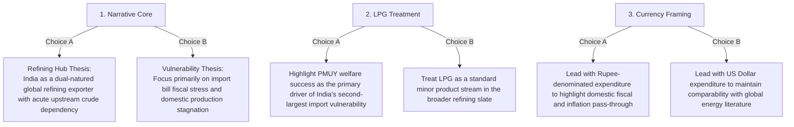

# Phase 8: Empirical Limitations, Methodological Boundaries, and Open Research Decisions

**Project Title:** *India's Petroleum Supply Chain and Import Exposure: A Historical Analysis of Domestic Production, Refinery Throughput, Petroleum Product Trade and Consumption*  
**Research Phase:** Phase 8 — Supply-Chain Relationships, Statistical Analysis, and Robustness Checks  

---

## 1. Overview & Objective

This report details the statistical boundaries, empirical limitations, and strategic decisions emerging from Phase 8 analysis. Explicit documentation of these boundaries ensures that Phase 9 (Research Paper Drafting) maintains the highest standards of academic integrity and avoids over-interpreting descriptive statistical patterns.

---

## 2. Statistical and Econometric Limitations

### 2.1 Sample Size Constraints in Annual Time-Series Regressions
- **Boundary:** The verified core supply-chain panel spans 26 to 28 annual observations (FY 1998-99 to FY 2024-25).
- **Limitation:** While sufficient for bivariate correlation, exploratory OLS regression, and descriptive subperiod comparisons, an annual sample of $N = 26$ restricts the degrees of freedom for high-order Vector Autoregressions (VAR), multi-lag distributed lag models, or cointegration tests with multiple structural breaks.
- **Academic Treatment:** Time-series models must be presented as exploratory co-movement frameworks rather than definitive dynamic econometric structures.

### 2.2 Endogeneity and the Absence of Exogenous Policy Instruments
- **Boundary:** Petroleum imports, refinery throughput, and domestic consumption are determined jointly within a complex global macroeconomic and domestic regulatory system.
- **Limitation:** The project repository contains supply-chain volumes, trade values, and benchmark prices, but lacks exogenous instrumental variables (such as sudden external geopolitical sanctions shocks or domestic excise tax policy instruments) to cleanly identify structural price elasticity of demand.
- **Academic Treatment:** All regression coefficients must be interpreted as descriptive elasticities and historical associations; no causal claims regarding price-induced demand destruction should be asserted.

### 2.3 Accounting Identity Nature of Import Expenditure Models
- **Boundary:** Total import expenditure is defined by the mathematical identity:
  $$\text{Expenditure} = \text{Physical Volume} \times \text{Realized Unit Value}$$
- **Limitation:** OLS regressions of log-expenditure on log-volume and log-price yield $R^2 = 1.000$ and coefficients of $\beta_1 = 1.000, \beta_2 = 1.000$. While this confirms data integrity and accounting closure, it must not be misinterpreted as an econometric discovery of consumer demand behavior.
- **Academic Treatment:** Frame expenditure regressions strictly as accounting verification models, and focus substantive economic analysis on the relative contribution of volume growth versus price shocks in driving financial import exposure.

### 2.4 Lack of High-Frequency (Monthly/Weekly) Inventory Disclosures
- **Boundary:** Administrative workbooks report annual dispatches, sales, and trade, but do not provide continuous corporate commercial stock inventory data across all product streams.
- **Limitation:** Apparent product availability residuals cannot be cleanly decomposed into working inventory shifts versus unmeasured transit losses.
- **Academic Treatment:** Apparent product availability residuals must be presented as unmeasured supply wedges rather than audited inventory disclosures.

---

## 3. Prioritized Strategic Decisions for Phase 9 Research Paper Drafting

The following structural decisions should guide the framing of the research paper in Phase 9:

### Strategic Decision 1: Framing the Central Academic Thesis
- **Option 1A (Recommended — The "Dual Supply-Chain" Thesis):** Frame India's petroleum sector as a structural duality: an upstream economy facing chronic crude import exposure (>88%) alongside a downstream economy operating as a globally competitive export refining powerhouse for transport fuels (>118% self-sufficiency).
- **Option 1B (The "Vulnerability / Crisis" Thesis):** Frame the analysis purely around energy security risks, fiscal burdens, and the failure of domestic upstream extraction policies (NELP/HELP) to arrest crude import dependence.
- **Recommendation:** Option 1A captures the full empirical complexity and uniqueness of India's position in global energy markets.

### Strategic Decision 2: Framing the LPG Clean-Cooking Paradox
- **Option 2A (Recommended):** Dedicate a focused section to the structural divergence between transport fuels (huge export surplus) and LPG (massive import deficit of 18 MMT). Highlight that domestic welfare policies (Pradhan Mantri Ujjwala Yojana) successfully expanded clean household energy access while inadvertently escalating reliance on imported Middle Eastern LPG.
- **Option 2B:** Treat LPG as one of several disaggregated products without policy linkage.
- **Recommendation:** Option 2A provides high-impact policy relevance that bridges energy security with socio-economic welfare.

### Strategic Decision 3: Currency Presentation in Macroeconomic Analysis
- **Option 3A (Recommended):** Present dual-currency metrics throughout the paper. Use US Dollars for international unit values, CIF-FOB spreads, and cross-country comparisons; use Indian Rupees (Rs. Lakh Crore) when discussing the domestic fiscal exchequer, refinery working-capital requirements, and current account deficit (CAD) pressures.
- **Option 3B:** Report exclusively in US Dollars.
- **Recommendation:** Option 3A reflects the empirical finding from Phase 8 that Rupee depreciation added a compounding +3.10% per annum to domestic import costs.

---

## 4. Methodological Declaration: Separation of Facts, Calculations, and Interpretations

To maintain clarity in the research paper:

1. **Observed Primary Facts:**
   - Domestic crude production averaged 34.1 MMT over 26 years.
   - Crude imports expanded from 39.8 MMT to 234.3 MMT.
   - Refinery throughput grew from 68.5 MMT to 261.5 MMT.
   - Crude import bill reached \$133.4 Billion (Rs. 11.05 Lakh Crore) in FY24.
2. **Empirical Calculations:**
   - Production-to-throughput coverage ratio fell from 47.8% to 11.2%.
   - Crude import dependence proxy rose from 54.9% to 88.9%.
   - Correlation between domestic production and crude imports is $r = 0.096$ ($p = 0.641$).
   - Price shocks explain 84% of annual variance in import expenditure.
3. **Substantive Interpretations:**
   - India's crude import surge was structural and downstream-driven (refinery expansion), not the result of domestic extraction failure.
   - Domestic production increases would not have crowded out crude imports given the immense scale of downstream refining capacity.
   - India's downstream refining sector serves as an effective physical buffer against external product shocks, even as its crude import exposure reaches historic highs.
