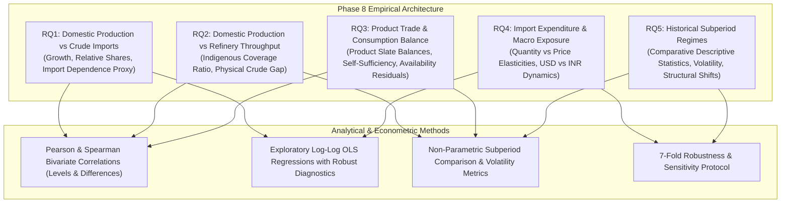

# Phase 8: Statistical Methodology and Analytical Framework

**Project Title:** *India's Petroleum Supply Chain and Import Exposure: A Historical Analysis of Domestic Production, Refinery Throughput, Petroleum Product Trade and Consumption*  
**Research Phase:** Phase 8 — Supply-Chain Relationships, Statistical Analysis, and Robustness Checks  

---

## 1. Methodological Principles & Scientific Safeguards

Phase 8 executes an empirical analysis of India's petroleum supply chain across 5 research questions (RQ1 to RQ5). To prevent over-interpretation and spurious inference, the analysis adheres strictly to the following methodological principles:

1. **Non-Equivalence of Domestic Production Increases and Import Reductions:** Crude oil imports are driven primarily by total refinery crude processing requirements (downstream throughput), not by domestic extraction capacity. Domestic production changes do not imply one-for-one import displacement.
2. **Correct Nomenclature for Supply Ratios:** The ratio of domestic crude oil production to refinery crude processing ($\frac{\text{Production}}{\text{Throughput}} \times 100$) is an **indigenous crude coverage ratio**. It is strictly **not refinery capacity utilization** (which measures throughput against nameplate distillation capacity).
3. **Refining Mass Balance Distinctions:** Refinery crude processing represents physical crude input, while petroleum-product production represents refined product output. The two differ due to refinery internal fuel use, processing losses, and volumetric expansion from catalytic hydrocracking (hydrogen addition).
4. **Separation of Crude Oil from Refined Petroleum Products:** Physical crude balances and refined product balances operate under distinct economic drivers (upstream procurement vs. downstream market demand). Crude and products are never commingled in physical accounting.
5. **Realized Import Unit Values vs. Pure Market Prices:** Calculated import unit values ($\frac{\text{Value}}{\text{Quantity}}$) represent realized, volume-weighted CIF import costs. They reflect quality grade differentials, long-term contract pricing formulas, and freight/insurance margins; they must not be interpreted as pure spot market price quotes.
6. **Accounting Identities vs. Causal Regressions:** Regressions of import expenditure on quantities and prices ($\ln V = \beta_0 + \beta_1 \ln Q + \beta_2 \ln P$) are descriptive representations of the accounting identity $V = Q \times P$; they do not establish causal macroeconomic demand elasticities.

---

## 2. Research Questions and Empirical Specifications

### 2.1 RQ1 — Domestic Production and Crude-Oil Imports
- **Formulas & Indicators:**
  - *Crude Import-to-Production Ratio:*
    $$\text{Ratio}_{t} = \frac{\text{Crude Imports}_{t}}{\text{Domestic Crude Production}_{t}}$$
  - *Crude Import-Dependence Proxy (%):*
    $$\text{Proxy}_{t} = \left[\frac{\text{Net Crude Imports}_{t}}{\text{Domestic Production}_{t} + \text{Net Crude Imports}_{t}}\right] \times 100$$
  - *Bivariate Association:* Pearson product-moment ($r$) and Spearman rank ($\rho$) correlations evaluated in both levels ($X_t, Y_t$) and annual first differences ($\Delta X_t, \Delta Y_t$).
  - *Exploratory Regression:*
    $$\ln(\text{Crude Imports}_t) = \alpha + \beta_1 \ln(\text{Domestic Production}_t) + \beta_2 \ln(\text{Refinery Throughput}_t) + \epsilon_t$$

### 2.2 RQ2 — Domestic Production and Refinery Processing
- **Formulas & Indicators:**
  - *Production-to-Processing Ratio (%):*
    $$\text{Ratio}_{t} = \left(\frac{\text{Domestic Crude Production}_{t}}{\text{Refinery Crude Processing}_{t}}\right) \times 100$$
  - *Physical Crude Deficit Gap (TMT):*
    $$\text{Gap}_{t} = \text{Refinery Crude Processing}_{t} - \text{Domestic Crude Production}_{t}$$
  - *Refining Multiplier:*
    $$\text{Multiplier}_{t} = \frac{\text{Refinery Crude Processing}_{t}}{\text{Domestic Crude Production}_{t}}$$

### 2.3 RQ3 — Petroleum-Product Trade, Production, and Consumption
- **Formulas & Indicators:**
  - *Product-Specific Net Trade Balance (TMT):*
    $$\text{Net Trade}_{i,t} = \text{Exports}_{i,t} - \text{Imports}_{i,t}$$
  - *Product Self-Sufficiency Ratio (%):*
    $$\text{SSR}_{t} = \left(\frac{\text{Total Product Production}_{t}}{\text{Total Product Consumption}_{t}}\right) \times 100$$
  - *Product Trade Shares (%):*
    $$\text{Share}^{\text{Exp}}_{i,t} = \frac{\text{Exports}_{i,t}}{\sum \text{Exports}_t} \times 100, \quad \text{Share}^{\text{Imp}}_{i,t} = \frac{\text{Imports}_{i,t}}{\sum \text{Imports}_t} \times 100$$
  - *Apparent Product Availability Residual (TMT):*
    $$\text{Residual}_{i,t} = \text{Production}_{i,t} + \text{Imports}_{i,t} - \text{Exports}_{i,t} - \text{Consumption}_{i,t}$$

### 2.4 RQ4 — Import Expenditure, Physical Quantities, and Price Effects
- **Formulas & Indicators:**
  - *Crude Realized Import Unit Value:*
    $$\text{UV}^{\text{USD/MT}}_{t} = \frac{\text{Crude Import Value (USD M)}_t \times 1,000}{\text{Crude Import Quantity (TMT)}_t}$$
    $$\text{UV}^{\text{USD/bbl}}_{t} = \frac{\text{UV}^{\text{USD/MT}}_{t}}{7.33}$$
  - *Realized CIF-to-FOB Spread ($/bbl):*
    $$\text{Spread}_{t} = \text{UV}^{\text{USD/bbl}}_{t} - \text{Indian Basket FOB Price}_{t}$$
  - *Import Expenditure Elasticity Identity Regressions:*
    $$\ln(\text{Expenditure}^{\text{USD}}_t) = \beta_0 + \beta_1 \ln(\text{Quantity}_t) + \beta_2 \ln(\text{Unit Value}^{\text{USD}}_t) + u_t$$
    $$\ln(\text{Expenditure}^{\text{INR}}_t) = \gamma_0 + \gamma_1 \ln(\text{Quantity}_t) + \gamma_2 \ln(\text{Unit Value}^{\text{INR}}_t) + v_t$$

### 2.5 RQ5 — Changes Across Historical Subperiods
Four historical subperiods are defined based on institutional and economic turning points:
1. **Subperiod 1 (FY 1998-99 to FY 2004-05, $N = 7$):** APM dismantling, private refining entry (Jamnagar DTA), emergence of product export capability.
2. **Subperiod 2 (FY 2005-06 to FY 2013-14, $N = 9$):** SEZ export refining boom, commodity super-cycle (crude reaching \$112/bbl), peak product self-sufficiency.
3. **Subperiod 3 (FY 2014-15 to FY 2019-20, $N = 6$):** Global crude price collapse (\$45–\$65/bbl), diesel deregulation, PMUY LPG demand acceleration, domestic production stagnation.
4. **Subperiod 4 (FY 2020-21 to FY 2024-25, $N = 5$):** Pandemic contraction and rebound, geopolitical crude realignment (Russian inflows), record import expenditure.

---

## 3. Seven-Fold Robustness and Sensitivity Protocol

To verify that findings are not artifacts of specific sample choices, Phase 8 conducts 7 structured sensitivity checks:

1. **Period Sensitivity:** Re-estimating correlations and growth rates across 10-year rolling windows and excluding early APM years (post-2002).
2. **Outlier Sensitivity:** Evaluating results with and without the extreme COVID-19 demand shock year (FY 2020-21) and the FY 2008-09 financial crisis.
3. **Definition Sensitivity:** Re-estimating domestic crude production relationships using pure crude oil (excluding lease condensate) for the post-2006 panel.
4. **Currency Sensitivity:** Comparing trade value elasticity and expenditure decompositions in USD vs. Indian Rupees (INR) to isolate foreign exchange depreciation effects.
5. **Level vs. Growth Rate Sensitivity:** Comparing high-level collinear level correlations with annual first-difference ($\Delta$) and percentage growth rate correlations.
6. **Missing-Data & Sample Alignment Sensitivity:** Comparing pairwise matched samples ($N=26$) with unrestricted full series ($N=28$).
7. **Product Aggregation Sensitivity:** Comparing macro product trade balances with disaggregated clean product streams (HSD, MS, ATF, LPG).
